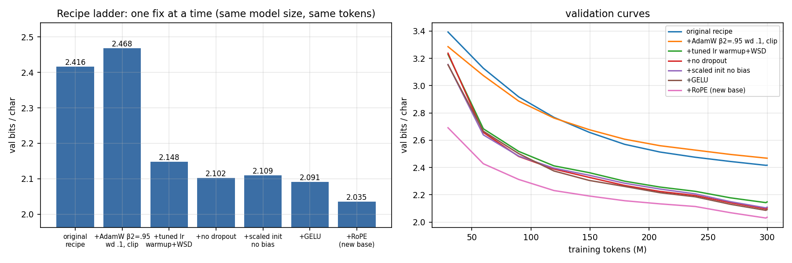
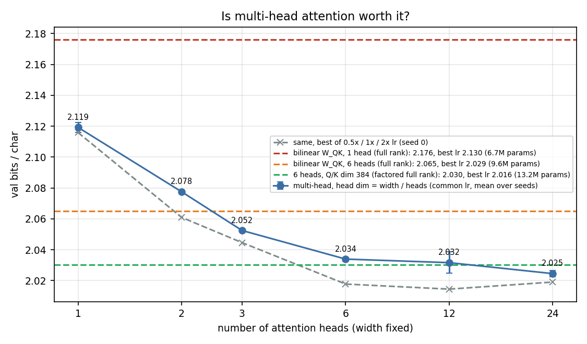
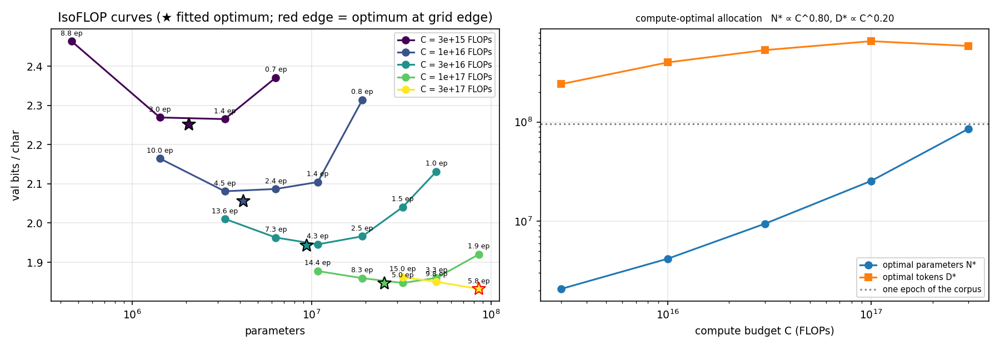
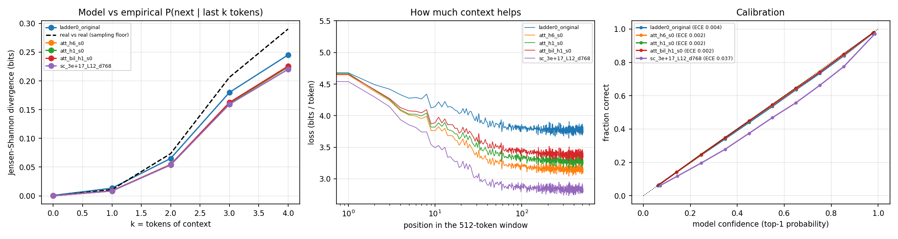

# Shaaer: a small GPT for classical Arabic poetry

Decoder-only transformers and a BPE tokeniser, written and trained from scratch on 152M characters of classical Arabic poetry, with controlled experiments on the training recipe, attention, model shape and scale.

The project started from Andrej Karpathy's video [*Let's build GPT: from scratch, in code, spelled out*](https://www.youtube.com/watch?v=kCc8FmEb1nY), where he builds a character-level GPT on Shakespeare. Shaaer applies the same idea to Arabic poetry and then goes further: its own tokeniser, metre/theme prompting, and about 90 training runs to see what actually matters. The base architecture follows his [nanoGPT](https://github.com/karpathy/nanoGPT).

All numbers come from `results/` and were produced in one overnight run on a single A100.

## Results in short

- **The original setup was losing 0.38 bits per character.** Same 7.3M-parameter model, same 300M tokens: **2.417 → 2.035**. Most of the gain is the learning rate and schedule (−0.32) and rotary positions (−0.06).
- **Multi-head attention helps up to about 6 heads.** At fixed width and parameter count, 1 → 6 heads lowers the loss by 0.085; 6 → 24 changes almost nothing.
- **Replacing Q·Kᵀ by one learned full matrix per head does not help.** It is worse or on par, and 2.8× slower with 6 heads.
- **The model has rhyme heads.** In the 6-head model, one head in layer 2 puts 32× its uniform share of attention on the previous lines' endings. Switching it off raises the loss on line-final tokens by 1.14 nats.
- **Best model: 1.832 bits/char** (85M parameters). bzip2 gets 3.396 on the same text.
- **This corpus is data-limited.** The compute-optimal model size grows as C^0.80 and its token budget only as C^0.20, against about 0.5 / 0.5 in Chinchilla.
- **Generated poems get closer to real ones as models grow.** Lines that share the poem's rhyme letter: 83% for the 85M model, 87% for real poems. Invented rhyme words fall from 19% to 6% (real poems: 4%).

## Data

[Ashaar](https://huggingface.co/datasets/arbml/ashaar), 199,770 poems with 3 to 60 lines. Exact duplicates are removed and the train/validation split is done by poem; validation poems sharing any line with training are moved to training, so **0% of validation lines appear in training**. In the first version of this project, 15.8% did, so its numbers are not comparable with these.

Each poem starts with a header `[metre|theme]`, e.g. `[الطويل|عامه]`, so prompting with a header asks for that metre and theme. The two halves of a line are separated by ` # `. Tashkeel is removed and letter variants are unified. BPE with 512 tokens, fitted on the training split.

## Experiments

| experiment | question | answer |
|---|---|---|
| learning rate vs width | How should the learning rate shrink with width? | lr ∝ width^−0.73 |
| recipe ladder | Was the original recipe holding the model back? | Yes, by 0.38 bits/char |
| number of heads (1 to 24) | Does splitting the width into heads help? | Yes up to ~6, flat after |
| full Q·Kᵀ matrix per head | Is the low rank of standard heads a bottleneck? | No |
| head analysis | What do the heads do? | Some heads track the rhyme |
| depth vs width | Deep-narrow or shallow-wide at 7M parameters? | Deeper wins: 16 × 192 scores 2.014, 4 × 384 scores 2.035 |
| scaling (23 runs, 5 budgets) | Best model size for each compute budget? | N* ∝ C^0.80, D* ∝ C^0.20 |
| distillation | Does training on a bigger model's predictions help? | Yes: −0.042 at equal tokens |
| distribution checks | Where does the model match the real text? | Short range: within sampling noise. The gaps are long-range |
| generation | Rhyme, invented words, copying vs real poems | Improves with scale, no copied lines |

Most runs train on 300M tokens (3.1 epochs) with one seed. Where two seeds exist they differ by up to 0.014 bits/char, so smaller gaps are noise.

**Recipe ladder: one change at a time**

**Number of heads**

**Scaling**

The largest budget's optimum sits on the edge of the grid, so the last point of the fit is a lower bound.

**Model vs real text: short-range statistics, use of context, calibration**

The per-head analysis for every attention variant is in [`figs/v2_head_analysis.png`](figs/v2_head_analysis.png), and every run is listed in [`results/summary.md`](results/summary.md).

## Limitations

- One seed for most runs. For 8 of the 9 attention variants, the best learning rate tried was the largest (2×), so some may do slightly better.
- Metre is not measured automatically yet; rhyme, invented words and copying are.
- The 85M model is slightly overconfident (calibration error 0.037 against 0.002 for the small models).

## Code

- `shaaer/`: tokeniser (`tok.py`), data pipeline (`data.py`), model with all attention variants (`model.py`), training (`train.py`), head and generation analysis (`analysis.py`), experiment suite (`suite.py`), follow-up analyses (`extras.py`), figures (`plots.py`).
- `shaaer_v2_experiments.ipynb`: the Colab notebook that ran everything (about 9.5 h for the suite and 1.5 h for the follow-ups on an A100). It is resumable: finished runs are skipped.
- `arabic_gpt.ipynb`, `prepare_ashaar.py`: the first version, a smaller study on an L4.

## References

- Karpathy, A. *Let's build GPT: from scratch, in code, spelled out* (video) and *nanoGPT*.
- Sennrich, Haddow & Birch (2016). *Neural Machine Translation of Rare Words with Subword Units.*
- Su et al. (2021). *RoFormer: Enhanced Transformer with Rotary Position Embedding.*
- Hoffmann et al. (2022). *Training Compute-Optimal Large Language Models.*
- Muennighoff et al. (2023). *Scaling Data-Constrained Language Models.*
- ARBML. *Ashaar* dataset.
