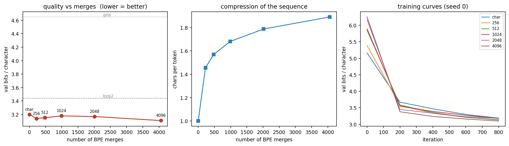

# Shaaer: a small GPT for classical Arabic poetry

A decoder-only transformer and a BPE tokeniser, both written from scratch and trained on classical Arabic poetry, plus a few controlled experiments on tokenisation, model width and corpus size.

The project started from Andrej Karpathy's video [*Let's build GPT: from scratch, in code, spelled out*](https://www.youtube.com/watch?v=kCc8FmEb1nY), where he builds a character-level GPT on Shakespeare. Shaaer applies the same idea to Arabic poetry, then adds its own BPE tokeniser, metre/theme prompting and experiments. The architecture follows his [nanoGPT](https://github.com/karpathy/nanoGPT).

## Results in short

- **More data was the only large effect.** Going from 2.65M to 162M characters lowered validation loss from **2.68 to 2.25 bits per character** (bzip2: 3.44 on the small corpus). Tokeniser and width changes moved it by much less.
- **The model keeps the rhyme.** Prompted with a metre and a theme, the 7.5M-parameter model ends all 9 lines of a poem on the same letter (qāf), stays in the theme's vocabulary, and copies no line from the corpus. Nothing in the architecture enforces rhyme.
- **The tokeniser and width experiments were inconclusive.** They stopped before convergence and gave coarser tokenisers more text per step, so they don't settle their questions.

## Data and model

| corpus | content | characters |
|---|---|---:|
| [MetRec](https://github.com/ARBML/MetRec) | 55,075 single verses | 2.65M |
| [Ashaar](https://huggingface.co/datasets/arbml/ashaar) | 199,770 full poems | 162M |

Each Ashaar poem starts with a header `[metre|theme]`, e.g. `[الكامل|غزل]`, so prompting with a header asks for that metre and theme. The two halves of a line are separated by ` # `. Text is normalised (tashkeel and tatweel removed, letter variants unified); prompts go through the same normalisation.

Tokeniser: character level or BPE, written from scratch and fitted on the training split only. Each letter is kept together with its diacritics before BPE; this has no effect on the results below, which all use text without tashkeel.

Model: nanoGPT-style, 4 layers, width 384, 6 heads, context 512, **7.49M parameters**. AdamW, lr 3e-4, one NVIDIA L4 on Colab.

Everything is reported in **bits per character**, so models with different tokenisers can be compared.

## Experiments

| experiment | question | answer |
|---|---|---|
| Number of BPE merges (MetRec, 1.9M params, 3 seeds) | Does tokeniser granularity matter? | Not settled: runs stopped at 800 iterations and coarser tokenisers saw up to 89% more text. |
| Vocabulary × width grid (150 runs) | Does the best width grow with vocabulary size? | Not settled: the best width was always the largest one tried. Side result: at 3M parameters, 2 wide layers beat 10 narrow ones by 0.32 bits/char. |
| BPE vs characters, same settings | Does BPE help? | No difference (2.682 vs 2.679, one seed). |
| MetRec → Ashaar | Does more data help? | Yes: 2.68 → 2.25. |




**Caveats.** The 2.68 and 2.25 come from different validation sets. Some Ashaar validation lines also appear in training, so 2.25 is somewhat optimistic; results on a de-duplicated split will be added here.

## Sample

Prompt `[الكامل|غزل]` + `وردة`, temperature 1.0, top-k 20:

```
ورده غناء # وازدح بالاطارق
وملاح طرفي بالار # د تواترها بالطارق
ووجنتي الاكوان # حكمتهم والنازق
ما شك الا عله # ما شبه الا بالحانق
فاهتزن الاصفر # بخده والخمر عاشق
من بعدكم بالله يا # له مؤذن بالشقاق
وسمعت بالخمس وال # قلب الرضا بالشقاق
وذكركم بالله ان # ن مجمع الكفارق
ان كان قد صان في # دل لي علي المغوارق
```

- **Gets right:** one rhyme letter throughout, one ` # ` per line, ghazal vocabulary (خمر, خده, طرفي), no copied lines.
- **Gets wrong:** some rhyme words are invented (الكفارق, المغوارق), and بالشقاق is repeated on consecutive lines.
- **Metre is not measured yet.** Some halves scan as the two-foot form of al-kāmil, others are too short.
- Words split across the two halves (بالار # د) also occur in the training data. In classical prosody this is *tadwīr*, not an error.

## Run it

Colab with a GPU: upload `prepare_ashaar.py`, run `arabic_gpt.ipynb` top to bottom (`QUICK = True` for a 10-minute test).

```python
m, tok, ck = load_gpt("gpt_B_plain_bpe_ashaar.pt")
txt = write_poem((m, tok, ck), prompt_raw="[الكامل|غزل]\nوردة", n=200, temperature=1.0, top_k=20)
```

Read samples from the saved file rather than the notebook output, which can reorder right-to-left text.

## References

- Karpathy, A. *Let's build GPT: from scratch, in code, spelled out* (video) and *nanoGPT*.
- Sennrich, Haddow & Birch (2016). *Neural Machine Translation of Rare Words with Subword Units.*
- Yang et al. (2018). *Breaking the Softmax Bottleneck.*
- Hoffmann et al. (2022). *Training Compute-Optimal Large Language Models.*
- ARBML. *MetRec* and *Ashaar* datasets.
