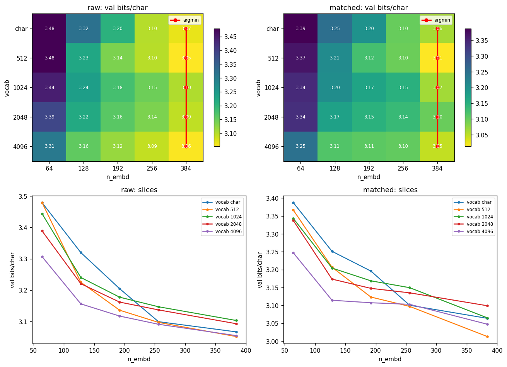

# A GPT for Classical Arabic Poetry

### A study of tokenisation, model width, and what a bits-per-character number is actually worth

---

## 0. What this document is

This is the write-up of a from-scratch implementation of a decoder-only
transformer language model — the nanoGPT architecture — trained on classical
Arabic poetry, together with three controlled experiments run on top of it.

It is written to be readable by someone who has never trained a neural network.
Sections 2 through 4 build the whole object from nothing: what a language model
is, what information theory says a loss number means, what a tokeniser does, and
what every matrix inside the transformer is for. Sections 5 through 8 are the
experiments and their results. Section 9 places the whole thing inside the
scaling literature. Section 10 is an honest account of what these results do
*not* establish, which for a study of this size is the most important section.

The code lives in `arabic_gpt_study.ipynb`. Every number quoted here was
produced by a cell in that notebook and is reproducible from it.

**Three results in one paragraph.** (i) On a 2.65M-character corpus, the choice
of tokeniser — character-level versus BPE at five vocabulary sizes — moved
validation loss by less than 0.1 bits per character, but the sweep ran for only
800 iterations, the training curves had not flattened, and at fixed iterations
the BPE models were shown nearly twice as much text as the character model; the
comparison does not survive those two facts (§6.3). (ii) A 5×5 joint sweep over
vocabulary size and model width found the best width at the edge of the grid in
all ten rows, which means the sweep could not have detected the interaction it
was designed to test — a negative result that is an artefact of the grid, not a
finding about the parameters (§7.4). (iii) Moving from the 2.65M-character
corpus to a 162M-character corpus dropped validation loss from 2.68 to 2.25 bits
per character. That is the only large, clean effect in the study, and it is on
the one variable that was never the object of an experiment.

**A note on provenance.** The results below come from cells executed across
several sessions, and the notebook does not record the hyperparameters in force
at each execution. Where a number is *measured* — printed by a cell, or readable
off a saved figure — it is stated plainly. Where it is *derived* or *inferred*,
it is marked. Section 5.2 explains how the iteration counts were reconstructed
and which ones remain uncertain; §12 recommends the change that would stop this
being necessary.

---

## 1. The object of study

### 1.1 The task

A **language model** assigns a probability to every possible piece of text. That
is the whole definition. Everything else — generation, "understanding",
completion — falls out of it.

Concretely, given a sequence of symbols $x_1, x_2, \dots, x_T$, the model
produces

$$P(x_1, \dots, x_T) = \prod_{t=1}^{T} P(x_t \mid x_1, \dots, x_{t-1}).$$

This factorisation is just the **chain rule of probability**, applied
left-to-right. It is not an approximation — it is exactly true for any joint
distribution. What it buys us is that a model which can answer one question,
*"given everything so far, what comes next?"*, automatically defines a
probability over all of language.

A model that can answer that question can also *write*: sample $x_1$ from the
model, feed it back in, sample $x_2$, and so on. Generation is not a separate
capability bolted on. It is the same machine run in a loop.

### 1.2 Why classical Arabic poetry

The corpus is not a neutral choice. Classical Arabic verse has three properties
that make it an unusually sharp test object.

**It is metrically constrained.** Every poem is written in one of the sixteen
classical metres (بحور) codified by al-Farāhīdī. A metre is a fixed pattern of
long and short syllables that repeats across every line. This is a *hard,
checkable* constraint: a line either scans or it does not. Most language-model
benchmarks have no such property.

**It rhymes on a single letter for the whole poem.** The قافية (rhyme) of a
classical qaṣīda is fixed at the first line and every subsequent line must end
on it — a poem "in lām" ends every line in ل, for hundreds of lines. This is a
long-range dependency of a very specific kind: it is not semantic, it is not
syntactic, and it spans the entire document.

**It has a rigid two-part line.** Each line (بيت, *bait*) splits into two
hemistichs (شطر) of equal metrical weight. In the corpus this boundary is
encoded as ` # `.

So the corpus hands us three separable, mechanically verifiable structures at
three different length scales: syllable-level (metre), line-level (hemistich
split), and document-level (rhyme). A model can be scored on each independently.
That is rare and it is the main reason this corpus is more interesting than, say,
a dump of Wikipedia.

There is also a fourth property, which is a difficulty rather than a gift:
Arabic is **morphologically rich and orthographically underspecified**. A single
root (ك-ت-ب) generates dozens of surface forms; and short vowels (تشكيل) are
usually omitted in writing, so كتب on the page could be *kataba*, *kutiba*, or
*kutub*. Section 3 deals with the consequences.

### 1.3 The corpora

Two datasets are used, and the difference between them turns out to be the most
consequential variable in the entire study.

**MetRec** ([ARBML/MetRec](https://github.com/ARBML/MetRec), MIT licence) — about
55,000 individual verses scraped from الديوان, originally labelled by metre for a
classification task. The labels are stripped. Lines are isolated: there is no
poem structure, so no rhyme to learn across lines.

| variant | verses | characters | distinct characters |
|---|---:|---:|---:|
| plain (tashkeel stripped) | 55,075 | 2,653,532 | 34 |
| with tashkeel | 55,248 | 3,439,922 | 42 |

**Ashaar** ([arbml/ashaar](https://huggingface.co/datasets/arbml/ashaar)) —
254,630 complete poems with metadata: metre, theme, poet, era. Whole poems, so
the rhyme constraint is present in the data.

The Ashaar build pipeline (`prepare_ashaar.py`) filters out poems with an odd
number of hemistichs (a scraping artefact — a bait must have two), poems shorter
than `min_baits` or longer than `max_baits`, and optionally restricts to
pre-modern eras. It also prepends a conditioning header to each poem:

```
[الكامل|غزل]
اصبح الملك للذي فطر الخل # ق بتقدير للعزيز العليم
غافر الذنب للمسيء بعفو # قابل التوب ذي العطاء العميم
...
```

The header `[metre|theme]` is plain text, so the model learns it like any other
token sequence — and at generation time you can *prompt* with it to request a
metre and a theme. This is the cheapest possible form of conditional generation:
no architectural change, no extra loss term, just put the label in the text.

| variant | poems kept | baits | characters | distinct characters |
|---|---:|---:|---:|---:|
| plain | 199,770 | 3,186,831 | 161,956,130 | 39 |
| with tashkeel | 199,771 | 3,186,858 | 189,213,180 | 48 |

Rejections, out of 254,630 poems seen: 54,860 too short, 24,378 with an odd
hemistich count, 7,365 too long. Ashaar-plain is **61× larger than
MetRec-plain**.

### 1.4 Normalisation

Both pipelines apply the same normalisation, which is worth stating explicitly
because it silently determines what the model can and cannot represent:

- NFKC Unicode normalisation, and removal of tatweel (ـ), the elongation
  character used for justification.
- All hamza-carrying alifs collapse to bare alif: إ, أ, آ, ٱ → ا.
- Alif maqṣūra → yāʾ: ى → ي.
- **Tāʾ marbūṭa → hāʾ: ة → ه.**
- Everything outside the Arabic letter range, the tashkeel range, space, and `#`
  is replaced with a space; runs of whitespace collapse.

The third of these has a consequence that bit us and is worth recording. The
original sampling prompt was **سميرة** (*Samira*). That word ends in ة, which
after normalisation *does not exist anywhere in the training data*. Feeding the
raw string to the tokeniser makes it silently drop the unknown final character,
leaving **سمير** — *Samir*, a different name, of the other gender. The fix is
that the prompt must go through **exactly the same normalisation function as the
training text**:

```python
def normalize_prompt(s, keep_dia):
    s = unicodedata.normalize("NFKC", s).replace(TATWEEL, "")
    if not keep_dia: s = TASHKEEL.sub("", s)
    s = re.sub("[إأآٱ]", "ا", s)
    return s.replace("ى","ي").replace("ة","ه")
```

This is a general principle and a common source of silent bugs: **any
transformation applied to training data must be applied identically at inference
time.** A train/inference skew of this kind produces no error message. It just
quietly degrades the output, and you spend an afternoon wondering why the model
is bad at a word it has seen ten thousand times.

---

## 2. What a loss number means

This section exists because the central methodological claim of the study lives
here, and because "loss went down" is meaningless until you know what units it
is in.

### 2.1 From probabilities to a training signal

The model outputs, at each position, a probability distribution over the
vocabulary. We need a single number saying how good that distribution is, and
that number needs to be differentiable so we can improve it by gradient descent.

The standard choice is **negative log-likelihood**. If the true next symbol is
$x_t$ and the model assigned it probability $p_t$, the loss at that position is
$-\log p_t$. Over a sequence:

$$\mathcal{L} = -\frac{1}{T}\sum_{t=1}^{T} \log P(x_t \mid x_{<t}).$$

Three reasons this is the right function and not an arbitrary one:

1. **Minimising it is maximum-likelihood estimation.** Summing $-\log p_t$ and
   minimising is exactly maximising $\prod_t p_t$, the probability the model
   assigns to the observed data. So it is not a heuristic score; it is the
   canonical statistical objective.
2. **It punishes confident errors without bound.** As $p_t \to 0$,
   $-\log p_t \to \infty$. A model that is 99% sure of the wrong answer is
   penalised far more than one that shrugged. This is what stops the model from
   collapsing to overconfident guesses.
3. **It is exactly a code length.** Which is the subject of the next subsection
   and the reason the whole study can use compression programs as baselines.

In code this is `F.cross_entropy(logits.view(B*T, C), targets.view(B*T))`, which
combines the softmax and the negative log in one numerically stable operation.
PyTorch reports it in **nats** (natural log). Divide by $\ln 2$ for bits.

### 2.2 Shannon: cross-entropy is a code length

This is the bridge that makes the numbers in this study interpretable.

Shannon's source coding theorem says: if symbols are drawn from a distribution
$P$, the shortest possible average code length is the entropy
$H(P) = -\sum_x P(x)\log_2 P(x)$ bits per symbol, and a symbol of probability
$p$ should be assigned a codeword of length $-\log_2 p$ bits. Rare events get
long codes, common events get short ones — this is why Morse code gives E a
single dot.

Now suppose you don't know $P$ and use your model $Q$ instead. Your average code
length becomes the **cross-entropy**

$$H(P, Q) = -\sum_x P(x) \log_2 Q(x) \;\ge\; H(P),$$

with equality only when $Q = P$. The gap is the KL divergence — the number of
bits per symbol you waste by having the wrong model.

**So the training loss, converted to bits, is literally the number of bits per
symbol an ideal compressor would need if it used your model to compress the
text.** This is not an analogy. Arithmetic coding achieves it to within a
fraction of a bit on the whole file.

Two things follow immediately:

- **A language model is a compressor**, and can be compared to gzip, bzip2, and
  lzma on the same axis, in the same units. This is the only reason section 2.4
  makes sense.
- **A loss number has an absolute floor**, the true entropy of the text. Nobody
  knows what it is for Arabic poetry, but the number is not "as low as
  possible" — it is bounded below by the genuine unpredictability of the
  language.

### 2.3 The comparability rule — the methodological core

Here is the rule the whole study is built around, and it is the single most
common mistake in tokeniser comparisons.

**Cross-entropy per token is not comparable across tokenisers.**

Why: cross-entropy is measured *per prediction step*, and different tokenisers
chop the same text into different numbers of steps. A character model predicting
the 2.65M characters of MetRec makes 2.65M predictions. A BPE model with 512
tokens makes about 1.69M — it takes bigger bites. Even if the two models are
*equally good*, the BPE model's per-step loss will be higher, because each of its
steps carries more of the text.

The effect is large and does not wash out. An untrained model, guessing
uniformly, scores $\ln(34) = 3.53$ nats on a 34-symbol character vocabulary and
$\ln(2048) = 7.63$ nats on a 2048-token BPE vocabulary. That factor of two is a
**units problem**, not a baseline offset — you cannot subtract it away, because
training moves the two numbers by different amounts.

The fix is to convert to **bits per character**, which is tokeniser-independent:

$$\mathrm{BPC} = \mathcal{L}_{\text{nats/token}} \times \frac{N_{\text{tokens}}}{N_{\text{chars}}} \times \frac{1}{\ln 2}$$

**Why this is exact and not an approximation.** By the chain rule, the total
negative log-probability the model assigns to the whole corpus is

$$-\log P(\text{corpus}) = \sum_{i} -\log P(t_i \mid t_{<i}) = \mathcal{L} \times N_{\text{tokens}}.$$

The left-hand side is a property of the *text and the model*, not of how the text
was chopped up — provided the tokenisation is **lossless and deterministic**,
so that the token sequence and the character sequence are two encodings of the
same object. Dividing by $N_{\text{chars}}$ then puts every tokeniser on one
axis, and dividing by $\ln 2$ converts nats to bits.

The losslessness precondition is not free, and the notebook enforces it with an
assertion rather than trusting it:

```python
_t = ArabicBPE.train(TEXT_PLAIN[:200000], 512)
assert _t.decode(_t.encode(TEXT_PLAIN[:5000])) == TEXT_PLAIN[:5000]
```

If that round-trip failed, every BPC number in this document would be wrong, and
wrong in a direction that flatters BPE (dropping characters makes the text look
more predictable). The assertion is cheap and it protects the entire study.

### 2.4 Compression baselines: what a good number looks like

Because a model *is* a compressor, general-purpose compressors give absolute
reference points. Run on MetRec:

| | plain (2.65M chars) | with tashkeel (3.44M chars) |
|---|---:|---:|
| UTF-8 on disk | 14.16 | 14.58 |
| uniform over the alphabet | 5.09 | 5.39 |
| gzip | 4.65 | 4.85 |
| **bzip2** | **3.44** | **3.49** |
| lzma | 3.66 | 3.67 |

Reading this table teaches you more about the corpus than a paragraph could.

- **UTF-8 costs 14 bits per character.** Arabic sits in a two-byte range of
  UTF-8, so every letter costs 16 bits on disk against an alphabet of 34
  symbols that needs only 5.09 bits to index. The file on disk is nearly 3×
  larger than a naive fixed-width encoding of the same content.
- **gzip only reaches 4.65.** gzip is LZ77 with a 32KB window and Huffman
  coding; it finds repeated substrings. That it barely beats a uniform code
  tells you Arabic poetry does not repeat long strings often — which is exactly
  what you would hope, since a poet who repeats whole phrases is a bad poet.
- **bzip2 reaches 3.44**, better than lzma here. bzip2 uses the
  Burrows–Wheeler transform, which sorts rotations of the text and so groups
  together characters appearing in similar contexts. It is unusual for it to
  beat lzma; it happens on text with strong local character-level statistics and
  weak long-range repetition, which describes this corpus well.
- **Tashkeel costs almost nothing per character.** 3.44 → 3.49 bits. The marks
  add 30% more characters but they are highly predictable from the consonants
  around them, so each one is cheap. That has a direct implication for the 2×2
  in section 8: *BPC is the wrong metric for the tashkeel axis*, since the
  tashkeel corpus has more characters to spread its bits over. Section 8 uses
  **bits per verse** alongside it for that reason.

**bzip2's 3.44 is therefore the number to beat.** A neural model that cannot
outperform a 1996 compressor has not learned anything a sorting algorithm
doesn't already know.

> **Gap in the current results.** These baselines were computed on *MetRec*
> only. The headline result in section 8 is on *Ashaar*, and the compressor
> baselines for Ashaar were never computed. Since Ashaar is 61× larger and has
> whole-poem structure, its compressibility is almost certainly different, so
> the 2.2502 result in section 8 currently has **no compressor anchor on its own
> corpus**. This is one cell of work and should be run before publication.

---

## 3. Tokenisation

### 3.1 The problem

A neural network consumes vectors of numbers, not text. So something must map
text to a sequence of integers, each of which indexes a row of a learned
embedding table. That something is the **tokeniser**, and its design fixes what
the model can even see.

Two extremes:

- **Character level.** Vocabulary is the set of distinct characters (34 for
  MetRec-plain). Nothing is ever out-of-vocabulary. But sequences are long, and
  the model must spend capacity learning that ا+ل+ك+ت+ا+ب is one word.
- **Word level.** Vocabulary is the set of distinct words. Sequences are short
  and each token is meaningful. But the vocabulary is enormous and open-ended,
  and for Arabic it is catastrophic: a single root generates dozens of inflected
  forms, each a separate unrelated entry, and any unseen form is simply unknown.

**Byte-pair encoding (BPE)** interpolates between them, and that interpolation
is what Study 1 sweeps.

### 3.2 The Arabic complication: combining marks

Before BPE can run, there is a problem specific to Arabic that a naive
implementation gets wrong.

Arabic diacritics are **combining codepoints**. The word كَتَبَ is three visible
letters but *six* Unicode codepoints: ك, َ, ت, َ, ب, َ. A character-level model
over codepoints therefore spends half its sequence length, half its attention
budget, and half its context window on marks that are not independent symbols at
all — they are properties of the letter they sit on.

The fix is to cluster first: glue each base letter to its trailing marks and
treat the result as the atomic unit.

```python
COMBINING = "\u0610-\u061A\u064B-\u065F\u0670\u06D6-\u06ED"
CLUSTER_RE = re.compile(rf"[^{COMBINING}][{COMBINING}]*|[{COMBINING}]+")
def to_clusters(s): return CLUSTER_RE.findall(s)
```

The first alternative reads "one non-combining character followed by any run of
combining marks" — a grapheme cluster. The second alternative, `[COMBINING]+`,
catches **orphan marks**: diacritics with no base letter, which occur in the
corpus as scraping debris. Without that second branch those marks would match
nothing, `findall` would silently drop them, and the round-trip assertion in
§2.3 would fail — taking the exactness of every BPC number with it. A two-word
addition to a regex is load-bearing for the study's central metric.

There is also a free benefit. The corpus is *inconsistently* vocalised: the same
word appears sometimes marked, sometimes bare. Since clusters are the atoms, BPE
learns the marked and unmarked forms as **separate tokens**, which is exactly
what we want — they are, after all, different strings that the model must be
able to produce.

### 3.3 BPE, from scratch

The algorithm (Sennrich et al., 2016, adapting a 1994 compression scheme):

1. Start with the vocabulary = the set of atomic units (here, grapheme clusters).
2. Count every adjacent pair of units in the corpus.
3. Take the most frequent pair, merge it into a single new unit, add it to the
   vocabulary, record the merge.
4. Repeat until the vocabulary reaches the target size.

Worked example on Arabic. Suppose ا and ل are frequently adjacent — they are, ال
is the definite article. The first merge produces `ال`. Now `ال` is a unit, and
the counting repeats; `ال` + `ك` may now be the most frequent pair, giving
`الك`. After a few thousand merges the vocabulary contains whole common words,
common prefixes, common roots, and the individual letters as a fallback.

The result is that **frequency determines granularity automatically.** Common
words become single tokens; rare words decompose into pieces; nothing is ever
out of vocabulary, because the atomic units are always still there.

The notebook's `ArabicBPE.train` is not the naive implementation. The naive
version recounts all pairs after every merge, costing $O(\text{merges} \times
\text{corpus})$, which on 145M characters would be untenable. Instead it keeps
incremental pair counts and an inverted index `where: pair -> {words containing
it}`, so each merge only touches affected words:

```python
pairs, where = Counter(), {}
for w, f in words.items():
    sp = splits[w]
    for i in range(len(sp)-1):
        p = (sp[i], sp[i+1]); pairs[p] += f; where.setdefault(p, set()).add(w)
while len(vocab) < vocab_size and pairs:
    best, cnt = pairs.most_common(1)[0]
    if cnt < 2: break
    ...
```

Two details worth noting. Counting is over `Counter(text.split())`, i.e. over
*word types weighted by frequency*, not over the raw character stream — so
merges never cross a space, and the tokeniser cannot produce a token spanning two
words. And `if cnt < 2: break` stops early when no pair repeats, which is why the
requested vocabulary sizes are never quite reached: 512 requested yields 478
merges, 4096 yields 4062.

**Encoding.** At encode time the greedy merge order is replayed: repeatedly find
the pair in the current split with the lowest merge rank (earliest learned) and
apply it. Unknown clusters — for example a vocalised prompt fed to a tokeniser
fitted on unvocalised text — fall back to their individual codepoints and, if
still unknown, are dropped rather than raising:

```python
def _emit(self, tok, ids):
    if tok in self.stoi: ids.append(self.stoi[tok]); return
    for ch in tok:
        if ch in self.stoi: ids.append(self.stoi[ch])
```

This is a deliberate robustness/strictness trade. It means an out-of-domain
prompt degrades instead of crashing — and it also means the ة bug in §1.4 fails
*silently*. Both properties come from the same three lines.

### 3.4 The trade-off BPE actually makes

Increasing the vocabulary does four things at once, and they do not point the
same way:

| | effect of more merges |
|---|---|
| sequence length | **shorter** — fewer prediction steps per character (1.00 → 1.89 chars/token from char to 4096) |
| effective context | **longer** — a 512-token window covers 1.89× more text |
| embedding parameters | **more** — the table is `vocab × n_embd`; going 512 → 4096 adds 1.4M parameters at width 384 |
| per-token statistics | **worse** — rare tokens appear few times and stay undertrained |

The last row is the one people forget. A vocabulary of 4096 built from a 2.65M
character corpus has tokens appearing a handful of times in the entire dataset.
Their embedding rows receive gradient a handful of times. They are close to
random vectors at the end of training, and the model has spent parameters to
hold them.

There is no theory saying where the optimum sits. It depends on corpus size,
model size, and language. **That is what Study 1 measures.**

### 3.5 Leakage: fitting the tokeniser

One subtlety that is easy to get wrong. The tokeniser is *learned from data*, so
it is part of the model, so it must be fitted on the training split only:

```python
train_text = text[:int(len(text)*0.9)]
TOKCACHE[v] = ArabicBPE.train(txt or train_text, vocab_size=v)
```

Fitting on the whole corpus would leak information about the validation text into
the vocabulary — the merge list would encode which strings are frequent in the
validation set. The effect is small but it is real, and it biases in the
flattering direction, which is the dangerous one. Study 1 and Study 2 do this
correctly.

> **Known inconsistency.** In the 2×2 (§8), the *BPE* branch correctly fits on
> `tr = txt[:int(len(txt)*0.9)]`, but the *character* branch is constructed as
> `CharTokenizer(txt)` on the full text. For a character tokeniser this leaks
> only the character *inventory* — which distinct characters exist — not any
> frequency information, so the effect is negligible. It should still be made
> consistent, because a reader has to stop and work out that it is harmless.

---

## 4. The model, component by component

The architecture is a decoder-only transformer — GPT — following Karpathy's
nanoGPT. This section takes it apart completely. The configuration used for the
headline runs is `n_embd=384`, `n_head=6`, `n_layer=4`, `block_size=512`,
`dropout=0.1`, which at vocabulary 512 is **7.49M parameters**.

### 4.1 Embeddings and the residual stream

A token id is an integer with no meaning — token 47 is not "more" than token 12.
So the first thing the model does is look up a learned vector:

```python
s.tok = nn.Embedding(vocab, ne)     # vocab x 384 table
```

`nn.Embedding` *is* a lookup table, and it is trained by gradient descent like
anything else. After training, tokens used in similar contexts end up with
similar vectors. Nothing forces this; it emerges because the training signal
only ever reaches an embedding row through the predictions made from it, so rows
that need to support the same predictions get pushed together.

Position must be added separately, because attention (§4.2) is permutation-
invariant — it genuinely cannot tell first from last:

```python
s.pos = nn.Embedding(bs, ne)        # 512 x 384, one vector per slot
x = e + s.pos(torch.arange(idx.shape[1], device=idx.device))
```

Two consequences of *learned absolute* positions. The model cannot run on
sequences longer than `block_size`, because there is no vector for position 512.
And it must learn "position 40 is near position 41" from scratch, since nothing
in the parameterisation says so. Rotary embeddings (RoPE) fix both by encoding
*relative* position in the attention computation instead; this implementation
does not use them, and §11 lists it as the highest-value architectural change.

The sum of token and position embeddings is the **residual stream**: a
`(batch, time, 384)` tensor that every subsequent layer reads from and writes
back into, additively. It is worth holding this picture, because it explains why
the architecture looks the way it does — each block does not transform the
stream, it *adds a correction to it*.

### 4.2 Self-attention, and why a fixed matrix handles every situation

This is the heart of the architecture and the part that deserves the most care.

**The problem it solves.** To predict the token after `... بالله يا #`, the
model needs information from elsewhere in the sequence: the rhyme letter
established fifty tokens ago, the metre from the header, the word immediately
before. Different positions need different information from different places.
The mechanism must be *content-dependent* and it must be learnable.

**The mechanism.** For each position, project the residual-stream vector three
ways:

```python
s.key   = nn.Linear(ne, hs, bias=False)
s.query = nn.Linear(ne, hs, bias=False)
s.value = nn.Linear(ne, hs, bias=False)
```

The standard reading, which is a genuine aid to intuition:

- the **query** $q_t = W_Q x_t$ is *what position $t$ is looking for*;
- the **key** $k_s = W_K x_s$ is *what position $s$ advertises about itself*;
- the **value** $v_s = W_V x_s$ is *what position $s$ hands over if attended to*.

Position $t$ compares its query against every key by dot product. A large dot
product means alignment — this key matches what I want. Softmax over those
scores turns them into weights summing to one, and the output is the
corresponding weighted average of values:

$$\text{out}_t = \sum_{s \le t} \underbrace{\frac{\exp(q_t\!\cdot\!k_s/\sqrt{d})}{\sum_{s' \le t}\exp(q_t\!\cdot\!k_{s'}/\sqrt{d})}}_{a_{ts}} \; v_s$$

In code, for the whole sequence at once:

```python
k, q, v = s.key(x), s.query(x), s.value(x)
w = q @ k.transpose(-2, -1) * k.shape[-1] ** -0.5
w = w.masked_fill(s.tril[:T, :T] == 0, float('-inf'))
return s.drop(F.softmax(w, -1)) @ v
```

#### 4.2.1 The question: how does one fixed matrix cover every situation?

This is the thing that is genuinely confusing the first time, and it has two
parts to the answer.

**Part one: parameters are fixed, activations are not.**

There are two kinds of numbers in a network. **Parameters** ($W_Q$, $W_K$,
$W_V$) are learned during training and frozen afterwards. **Activations** ($q_t$,
$k_s$, $v_s$, and the attention weights) are computed fresh for every input, at
every position.

$W_Q$ is a parameter. $q_t = W_Q x_t$ is an activation. The *same* $W_Q$
produces a *different* query at every position, in every poem, because $x_t$
differs. One matrix, unlimited distinct queries.

The right way to read $W_Q$ is as a **question template** rather than a
question: *"given what I currently am, what should I be looking for?"* Apply
that template to the vector of a line-final token and it emits "find the rhyme
letter". Apply the identical template to a token mid-hemistich and it emits
something else entirely. The matrix does not store situations; it stores a
*rule for generating* the right query from the situation.

**Part two — and this is the real answer — the attention matrix is not a
parameter at all.**

The $T \times T$ matrix $A = \text{softmax}(QK^\top/\sqrt{d})$, which decides
which position reads from which, contains **no learned weights**. It is computed
at runtime, from the data, and it is *different for every single input sequence*.

This is what makes attention different in kind from a fully-connected layer. In
an MLP, the mixing weights *are* the parameters: input 3 always contributes to
output 7 with the same fixed strength. In attention, the mixing weights are
themselves a function of the input. The layer implements a **data-dependent
linear map** — the parameters define *how to compute* the mixing pattern, and
the pattern is then computed anew for each poem.

So: your model is trained once, and it has one $W_Q$. But feed it ten thousand
different poems and you get ten thousand different $T \times T$ routing patterns.
That is where "all the situations" come from.

**Part three: why this generalises to situations never seen.**

$W_Q$ is a *linear* map. Suppose during training it learns that some direction
$u$ in embedding space means "I am at the end of a hemistich" and that tokens
with a large component along $u$ should query for rhyme letters. Then *any*
token whose embedding has a component along $u$ inherits that behaviour —
including tokens, words, and contexts that never appeared in training.

The behaviour is encoded as a **geometric relation in vector space**, not as a
table of cases. That is the mechanism by which a fixed, finite parameter set
covers an unbounded set of situations. It is also why embeddings ending up
"similar for similar tokens" matters so much: similarity in embedding space is
what lets learned rules transfer.

And one more layer of generality: the same $W_Q$ is applied at **every
position** — this is weight sharing across time. It builds in the assumption
that a relation which holds at position 12 can hold at position 400, which for
poetry (where the rhyme rule is the same in line 2 and line 40) is exactly
correct.

#### 4.2.2 The causal mask

```python
s.register_buffer('tril', torch.tril(torch.ones(bs, bs)))
w = w.masked_fill(s.tril[:T, :T] == 0, float('-inf'))
```

`tril` is a lower-triangular matrix of ones. Setting the upper triangle to
$-\infty$ *before* the softmax makes those weights exactly zero after it, since
$e^{-\infty} = 0$. Position $t$ can attend to positions $\le t$ and nothing
later.

Without this the model would see the future and the task would be trivial and
useless. With it, one forward pass over a length-$T$ sequence produces $T$
correctly-conditioned predictions simultaneously — position 5 predicts token 6
using only tokens 1–5, position 6 predicts token 7 using 1–6, and so on, all in
parallel. That is the efficiency trick that makes training a language model
feasible at all: $T$ training examples for the price of one forward pass.

`register_buffer` (rather than `nn.Parameter`) marks the mask as state that moves
with the model to the GPU and is saved in the checkpoint, but is **not trained**.

#### 4.2.3 Why divide by $\sqrt{d}$

If $q$ and $k$ have independent components with roughly unit variance, their dot
product $\sum_{i=1}^{d} q_i k_i$ is a sum of $d$ terms, so it has variance $\approx
d$ and standard deviation $\approx \sqrt{d}$. As $d$ grows, the logits entering
the softmax grow with it.

Large logits make softmax saturate: one weight goes to 1, the rest to 0. And a
saturated softmax has a near-zero gradient, so the layer stops learning. Dividing
by $\sqrt{d}$ restores unit variance regardless of head size, which keeps the
softmax in its responsive range at initialisation. This one constant is the
difference between a transformer that trains and one that does not.

### 4.3 Multi-head attention: what actually changes

Here is the second question worth answering carefully: what does splitting into
six heads of 64 dimensions buy over one head of 384?

```python
class MultiHead(nn.Module):
  def __init__(s, ne, nh, bs, dr):
    hs = ne // nh                                     # 384 // 6 = 64
    s.heads = nn.ModuleList([Head(ne, hs, bs, dr) for _ in range(nh)])
    s.proj = nn.Linear(nh * hs, ne)
  def forward(s, x):
    return s.drop(s.proj(torch.cat([h(x) for h in s.heads], -1)))
```

**First, what does *not* change: the parameter count.** Six heads each project
$384 \to 64$, so $6 \times 384 \times 64 = 147{,}456$ per projection type —
exactly the same as one head projecting $384 \to 384$. The FLOP count is also
nearly identical. Multi-head attention is **not** a way of adding capacity. It
is a way of *spending the same capacity differently*.

**What changes: how many things can be attended to at once.**

A single head computes **one** probability distribution $a_{ts}$ per query
position. The output is $\sum_s a_{ts} v_s$ — and crucially, *every one of the
384 output dimensions uses those same weights*. One head can look in one place.

Now take a concrete case from this corpus. To generate the final token of a
line, the model needs simultaneously:

1. the **rhyme letter**, established possibly fifty tokens back;
2. the **metrical position** — how many syllables are left in this hemistich;
3. the **immediately preceding word**, for grammatical agreement.

With one head, the softmax must split its mass across all three locations, and
the output is a *blend* of three value vectors — an average that may correspond
to none of them. This is **destructive interference**, and it is the concrete
failure that motivates multiple heads.

With six heads, each computes its own independent $a^{(h)}_{ts}$ over its own
64-dimensional subspace. One head can lock onto the rhyme, another onto the
hemistich boundary, a third onto the previous word, and their outputs are
concatenated into disjoint slices of the 384-dimensional vector rather than
summed on top of each other. The final `s.proj` then learns how to combine those
six separately-retrieved pieces of information.

Structurally: a single head applies one convex combination to the whole vector;
$h$ heads apply a **block-diagonal** mixing, a different convex combination per
block. Same parameters, strictly richer set of achievable mixing patterns.

**The cost, and why 64 is the number.** Head dimension is $d_{\text{head}} =
n_{\text{embd}} / n_{\text{head}}$. The matrix $QK^\top$ has rank at most
$d_{\text{head}}$, so as heads multiply, each head's ability to *discriminate*
between candidate positions shrinks. Push it far enough and each head can only
express a crude similarity and attends to everything weakly. There is a real
trade: more heads = more simultaneous relations, each with less resolution.

Empirical practice across the literature has landed on $d_{\text{head}} = 64$,
which is exactly what this codebase hard-codes:

```python
nh = max(1, ne // 64)
```

So width 384 gives 6 heads, and width 512 would give 8 — the head count is not a
free parameter here, it is derived. That is a defensible choice and it removes a
dimension from the search space, but it should be stated rather than left
implicit, since it means Study 2's width sweep is *also* silently a head-count
sweep.

> **Known inefficiency.** This implementation loops over heads in Python
> (`torch.cat([h(x) for h in s.heads], -1)`) and materialises the full
> $B \times n_h \times T \times T$ attention matrix. The mathematics is identical
> to a batched implementation, but at batch 128, block 512, and 6 heads, the
> score tensor alone is ~800MB per layer and must be retained for the backward
> pass. Fusing the three projections into one `nn.Linear(ne, 3*ne)` and calling
> `F.scaled_dot_product_attention` is mathematically equivalent, 2–4× faster, and
> removes that memory entirely. This is the single change that would most enlarge
> the space of models this study can afford to train.

### 4.4 The feed-forward network

```python
s.net = nn.Sequential(nn.Linear(ne, 4*ne), nn.ReLU(),
                      nn.Linear(4*ne, ne), nn.Dropout(dr))
```

Attention moves information *between* positions but applies no nonlinear
transformation to it. The feed-forward network does the opposite: it processes
each position independently, with no communication, but nonlinearly.

Two facts. First, the alternation matters — attention gathers, then the FFN
thinks about what was gathered, and stacking these is what gives depth its power.
Second, the 4× expansion is where most of the parameters live: at width 384 the
FFN holds 1.18M of the 1.77M parameters in each block, about **67%**. When people
say a transformer is mostly MLP, this is the arithmetic they mean.

`ReLU` here; GELU is the modern default and is marginally better, though not
enough to explain any result in this study.

### 4.5 Residual connections and pre-norm LayerNorm

```python
def forward(s, x):
    x = x + s.sa(s.ln1(x))
    x = x + s.ff(s.ln2(x))
    return x
```

**Residuals.** Each sub-layer's output is *added* to its input rather than
replacing it. During backpropagation, the gradient flows through the `+`
unchanged — it takes a direct path from the loss to every layer, bypassing the
whole stack. This is what makes deep networks trainable; without it, gradients
shrink multiplicatively with depth and the early layers receive nothing.

The interpretation this licenses is the residual stream from §4.1: layers *add
corrections* to a shared representation, rather than transforming it. A block can
learn to contribute nothing (output ≈ 0) and the stream passes through intact,
which means adding depth is safe by default.

**LayerNorm** normalises each position's vector to zero mean and unit variance
across its 384 features, then applies a learned scale and shift. This keeps
activations in a stable range as they propagate.

Note the placement: `x + s.sa(s.ln1(x))` normalises *before* the sub-layer, not
after. This is **pre-norm**, and it matters. In the original 2017 post-norm
formulation the normalisation sits on the residual path itself, which disrupts
the clean gradient highway and requires a learning-rate warmup schedule to train
stably at depth. Pre-norm keeps the residual path free of normalisation and is
substantially more forgiving. It is the modern default for good reason.

### 4.6 The output head, weight tying, and the softmax bottleneck

```python
s.lm_head = nn.Linear(ne, vocab)
if not factor_rank:
    s.lm_head.weight = s.tok.weight        # weight tying
```

The final linear layer maps the 384-dimensional vector to one **logit** per
vocabulary entry — an unnormalised score, which softmax turns into probabilities.

**Weight tying** makes the output matrix the *same object* as the input embedding
table. The justification is that both are maps between the same two spaces
(token identity ↔ vector), just in opposite directions, so the geometry ought to
be shared. It saves `vocab × n_embd` parameters — 196,608 at vocabulary 512,
which is 2.6% of this model — and it typically improves quality, because every
embedding row now receives gradient from *two* sources: from being an input, and
from being an output target. Rare tokens benefit most, since they get more
gradient signal per appearance.

**The softmax bottleneck** (Yang et al., 2018) is the reason Study 2 exists, so
it is worth stating precisely. The logits are $h W^\top$ where $h$ is
384-dimensional and $W$ is $\text{vocab} \times 384$. Stack the log-probability
vectors for every possible context into a matrix; because it factors through a
384-dimensional bottleneck, that matrix has **rank at most 384**.

If the true conditional distributions of the language require higher rank, no
amount of training can express them — it is a representational ceiling, not an
optimisation failure. And the ceiling scales with `n_embd`, while the demand
scales with `vocab_size`. **A larger vocabulary genuinely requires a larger
width.** The two hyperparameters are coupled by construction, which is the entire
premise of the 2D grid in Study 2.

The `factor_rank` option implements ALBERT-style factorised embeddings
(`vocab × r` then `r × n_embd`) to decouple the two, but it is not used in any
run reported here.

### 4.7 Parameter arithmetic

For the headline configuration (vocab 512, `n_embd` 384, `n_layer` 4,
`block_size` 512):

| component | count |
|---|---:|
| token embedding (512 × 384) | 196,608 |
| position embedding (512 × 384) | 196,608 |
| per block — attention Q,K,V (3 × 384 × 384) | 442,368 |
| per block — attention output projection | 147,840 |
| per block — FFN (384→1536→384) | 1,181,568 |
| per block — 2 × LayerNorm | 1,536 |
| **per block total** | **1,773,312** |
| × 4 blocks | 7,093,248 |
| final LayerNorm + lm_head bias | 1,280 |
| **total** | **≈ 7.49M** |

The `lm_head` weight is not counted separately because it is tied. Note that
67% of the total is feed-forward, and that the two embedding tables together are
only 5% — at *this* vocabulary size. At vocabulary 4096 the token embedding alone
would be 1.57M, which is why Study 2's "raw" surface is confounded and needs the
parameter-matched companion described in §7.

### 4.8 Training

```python
opt = torch.optim.AdamW(m.parameters(), lr=3e-4)
for it in range(iters + 1):
    X, Y = batch_of("train")
    _, loss = m(X, Y)
    opt.zero_grad(set_to_none=True); loss.backward(); opt.step()
```

**Batching.** `batch_of` samples `batch` random start positions and takes
`block_size` consecutive tokens from each, with `Y` being `X` shifted by one.
Random offsets rather than a sequential scan means every epoch sees different
alignments — a form of free data augmentation, and it avoids any batch-boundary
periodicity.

**AdamW** maintains per-parameter running estimates of the gradient's mean and
variance, and scales each parameter's step by the inverse of its own gradient
magnitude. In a transformer, embedding rows for rare tokens and LayerNorm gains
receive gradients differing by orders of magnitude; a single global learning rate
cannot serve both. The `W` is decoupled weight decay (Loshchilov & Hutter, 2019),
which applies the decay directly to weights instead of folding it into the
gradient, where Adam's normalisation would otherwise scale it inconsistently.

**Dropout (0.1)** zeroes a random 10% of activations during training, forcing the
network not to depend on any single unit. Note that it is a regulariser against
*overfitting*, so the right value depends on how many times the data is repeated
— at 200 epochs it is essential, at 1 epoch it costs capacity for no benefit.
Section 9 shows this study spans both regimes, at a fixed 0.1.

**Evaluation** averages loss over 25 random batches from each split. This is an
*estimate*, not the exact validation loss, and its noise is one contributor to
the seed variance in Study 1.

> **Not implemented, and worth noting.** There is no learning-rate schedule
> (constant 3e-4), no warmup, and no gradient clipping. Standard practice is
> linear warmup followed by cosine decay to ~10% of peak, with `betas=(0.9,
> 0.95)` and `clip_grad_norm_(1.0)`. A cosine schedule is typically worth
> 0.02–0.05 bpc at this scale — which is *larger than the entire spread of Study
> 1*. That is not a criticism of the study's conclusion so much as a warning
> about what magnitude of effect it was trying to resolve.

### 4.9 Sampling

```python
logits = logits[:, -1, :] / temperature
if top_k:
    v, _ = torch.topk(logits, min(top_k, logits.shape[-1]))
    logits[logits < v[:, [-1]]] = -float('inf')
idx = torch.cat((idx, torch.multinomial(F.softmax(logits, -1), 1)), 1)
```

**Temperature** divides the logits before the softmax. Below 1 it sharpens the
distribution toward the most likely token — safer, more repetitive. Above 1 it
flattens it — more varied, more errors. At $T \to 0$ it becomes greedy argmax; at
$T \to \infty$, uniform.

**Top-$k$** discards everything outside the $k$ most likely tokens before
sampling. This removes the long tail of low-probability nonsense that would
otherwise be sampled occasionally simply because there is so much of it in
aggregate.

Note `idx[:, -s.bs:]` in the generation loop: context is truncated to
`block_size`, since there is no position embedding beyond it. Generating past 512
tokens means the model loses sight of the beginning of the poem — including the
`[metre|theme]` header and the line that established the rhyme. **This is a
direct, architectural limit on how long a coherent poem can be**, and it is
visible in the samples in §8.


---

## 5. Experimental protocol

### 5.1 Splits

Token ids are split 90/10 by position: `tr = data[:n]`, `va = data[n:]` with
`n = int(len(data) * 0.9)`. Because the corpus is a concatenation of whole poems
in dataset order, the validation split is the **last 10% of poems**, not a random
sample of lines. That has a virtue and a cost. The virtue is that no poem
straddles the boundary in a way that would let the model memorise one hemistich
in training and be scored on the other in validation. The cost is that the split
is not exchangeable: if Ashaar is ordered by poet or era, the validation set is
a systematically different distribution, and validation loss measures
*generalisation to a different distribution* rather than to held-out samples of
the same one. This makes the numbers conservative — which is the safe direction —
but it means they are not comparable to a randomly-split baseline.

### 5.2 What an iteration is, and how to count epochs

An **iteration** is one gradient step on one batch. One batch contains `batch`
sequences of `block_size` tokens, so:

$$\text{tokens processed} = \text{iters} \times \text{batch} \times \text{block\_size}$$

$$\text{epochs} = \frac{\text{tokens processed}}{0.9 \times N_{\text{tokens}}}$$

The 0.9 is essential: batches are drawn only from the training split, so the
denominator is the training tokens, not the whole corpus.

> **Bug, fixed here.** The notebook's `print("epochs =", 20000*32*512/len(ids))`
> is wrong three ways: it hard-codes an iteration count and a batch size that
> the run did not use, and it omits the 0.9. It also read a `len(ids)` left over
> from a different cell. It printed 1.73; the true figure for that run is about
> **7**. The corrected line is `iters*batch*block/(0.9*len(ids))`.

### 5.2.1 Reconstructing the iteration counts

The notebook was executed across several sessions and `ITERS` was edited between
them, so the cell that *defines* `ITERS` does not tell you what any given result
was produced with. The counts below are reconstructed from evidence in the saved
outputs, and the evidence differs in strength from row to row.

**Studies 1 and 2 ran at 800 iterations.** This is read directly off the
training-curve panel of `fig1_merges.png` (§6), whose x-axis runs from 0 to 800
with evaluation points at 0, 200, 400, 600 and 800 — consistent with
`eval_every = iters // 4 = 200`. It is corroborated by `train_one`'s default
argument (`iters=800`) and by the notebook header's estimate of 60–90 minutes on
a T4, which is unachievable at 20,000 iterations for 150 grid runs.

**The Study 3 run on Ashaar ran at 10,000 iterations.** Directly confirmed by the
run's own progress output: `100.0% 10000/10000 170.1m elapsed`.

**The Study 3 run on MetRec is unknown.** That cell carries execution count 11,
placing it *before* the execution of the cell that currently reads
`ITERS = 10000` (execution count 17). Its iteration count was not recorded and
cannot be recovered. Its epoch figure is therefore omitted below rather than
guessed, and no argument in this document rests on it.

| stage | iters | batch | block | tokens processed | train tokens | epochs |
|---|---:|---:|---:|---:|---:|---:|
| Studies 1–2, char | 800 | 32 | 128 | 3.28M | 2.39M | **1.4** |
| Studies 1–2, BPE-512 | 800 | 32 | 128 | 3.28M | 1.52M | **2.2** |
| Studies 1–2, BPE-4096 | 800 | 32 | 128 | 3.28M | 1.26M | **2.6** |
| Study 3 on MetRec, cells A, B | *unrecorded* | 32 | 512 | — | 2.39M / 1.52M | *unknown* |
| Study 3 on Ashaar, cell B | 10,000 | 128 | 512 | 655.4M | ≈92.8M † | **≈7** |

† **Derived, not measured.** The token count for the Ashaar BPE-512 corpus was
never printed — the `len(ids)` in that cell belonged to a different tokeniser.
It is estimated as 161,956,130 chars ÷ 1.57 chars/token, taking the ratio from
the MetRec BPE-512 measurement in §6. The true ratio on a 61× larger corpus will
differ, so treat "≈7 epochs" as accurate to roughly ±20%.

### 5.3 Hardware

All runs on a single NVIDIA L4 (24GB) via Colab Pro. Studies 1 and 2 together
took roughly 82 minutes for 150 grid runs plus the merge sweep. The single
completed Ashaar run in Study 3 took **170 minutes**. Peak GPU memory at batch
128, block 512, width 384 was about 16GB — dominated by the materialised
attention matrices discussed in §4.3.

---

## 6. Study 1 — the merge sweep

**Question.** How does model quality depend on how many times BPE glued two
symbols together? `merges = 0` is plain character level.

**Setup.** MetRec-plain. `n_embd=192`, `n_head=3`, `n_layer=4`, `block=128`,
`batch=32`, **800 iterations** (§5.2.1), 3 seeds per point, ≈1.9M parameters.
Tokeniser fitted on the training split only.

**Prediction, stated in advance.** BPC should fall then flatten as merges
increase — the flattening being the point where extra vocabulary stops buying
sequence compression and starts costing embedding parameters and undertrained
rare tokens.

### Results


| tokeniser | merges | chars/token | val BPC | sd (3 seeds) |
|---|---:|---:|---:|---:|
| char | 0 | 1.00 | 3.2008 | 0.0087 |
| BPE 256 | 222 | 1.46 | 3.1391 | 0.0004 |
| BPE 512 | 478 | 1.57 | 3.1516 | 0.0212 |
| BPE 1024 | 990 | 1.68 | 3.1790 | 0.0136 |
| BPE 2048 | 2014 | 1.79 | 3.1685 | 0.0090 |
| BPE 4096 | 4062 | 1.89 | **3.1092** | 0.0066 |

Sequence compression behaves exactly as theory says: chars per token rises
monotonically and with diminishing returns, 1.00 → 1.46 → 1.57 → 1.68 → 1.79 →
1.89. Doubling the vocabulary buys steadily less.

### What this actually shows

**Character-level is genuinely worst.** The gap from char (3.2008) to the best
BPE setting (3.1092) is 0.0916 bpc, about 8 standard deviations of the pooled
seed noise. That is a real effect.

**But the predicted shape did not appear.** Within BPE the ordering is
4096 < 256 < 512 < 2048 < 1024 — non-monotonic, and not a "fall then flatten"
curve. The best and second-best settings are the two *extremes* of the sweep,
with the middle three worse than both. There is no coherent story in which that
is the true shape of the curve.

### 6.3 Why the char-versus-BPE gap should not be believed either

Two problems, both visible in the figure above, and the second is fatal.

**The models had not converged.** The right-hand panel is the training curves,
and its x-axis ends at 800 — every run in this sweep stopped after 800
iterations, which is 1.4 epochs for the character model and 2.6 for BPE-4096
(§5.2.1). All six curves are still descending at the point the runs were cut
off; none has flattened. What the table reports is therefore not "quality per
tokeniser" but **"loss after 800 steps per tokeniser"**, and those are only the
same quantity if all six converge at the same rate — which is exactly the sort
of thing tokenisation changes.

**At fixed iterations, the tokenisers were not shown the same amount of text.**
This is the serious one. Each step consumes `batch × block_size` = 4,096
*tokens*, but a token is worth 1.00 characters under the character tokeniser and
1.89 under BPE-4096. So across 800 identical iterations:

| tokeniser | chars/token | characters seen in training |
|---|---:|---:|
| char | 1.00 | 3.28M |
| BPE-256 | 1.46 | 4.78M |
| BPE-512 | 1.57 | 5.14M |
| BPE-1024 | 1.68 | 5.50M |
| BPE-2048 | 1.79 | 5.87M |
| BPE-4096 | 1.89 | 6.19M |

**The BPE-4096 model was shown 89% more text than the character model.** The
reported 0.0916 bpc advantage of BPE over char is therefore confounded with a
near-doubling of data exposure, and the sweep provides no way to separate them.
Worse, the confound runs *monotonically along the axis being swept* — more
merges means more characters seen — so it could manufacture precisely the
downward trend the study predicted, out of nothing.

This does not show that BPE is no better than characters. It shows that **this
experiment cannot tell**. Fixing it requires equalising the budget in characters
rather than iterations: set `iters` per cell so that
`iters × batch × block × chars_per_token` is constant. That is a one-line change
and it should be made before the merge sweep is cited for anything.

Two further caveats, smaller but worth recording. Three seeds gives a poor
variance estimate — BPE-256's reported sd of 0.0004 is three draws that happened
to land close together, not a credible standard deviation. And the missing
learning-rate schedule (§4.8) is worth 0.02–0.05 bpc on its own, comparable to
much of the spread being measured.

### 6.4 Consequence for the rest of the study

**Consequence for the rest of the study.** `BEST_VOCAB = 512` was carried into
Study 3, but 512 ranks *third of six* in this sweep, and fifth of six among the
BPE settings. The choice actually came from Study 2's widest column (§7), where
512 does win — but the two studies rank vocabularies differently, which is itself
evidence that neither is resolving a real signal. The value 512 should be
regarded as **an arbitrary choice within a flat region**, not as an optimum, and
it should be re-derived at Ashaar scale before being trusted (§11).

---

## 7. Study 2 — the two-dimensional grid

### 7.1 Why a grid rather than two sequential searches

Optimising vocabulary at fixed width, then width at fixed vocabulary, is
**coordinate descent**. It finds the joint minimum only if the two variables do
not interact — if the valley of the loss surface runs parallel to an axis. If the
valley runs *diagonally*, coordinate descent halts at a point that is optimal
along each axis separately and optimal in neither jointly.

And here there is a concrete mechanism forcing a diagonal valley: the **softmax
bottleneck** of §4.6. `lm_head` maps $n_{\text{embd}} \to \text{vocab}$, so the
achievable log-probability matrix has rank at most $n_{\text{embd}}$. A larger
vocabulary genuinely *requires* a larger width to be representable. The two
parameters are coupled by construction. So sweep them jointly and look at whether
the ridge of best-width-per-vocabulary tilts.

### 7.2 Two surfaces

- **raw** — `n_layer` fixed at 4. A bigger vocabulary means more parameters.
  Honest, but confounded: any advantage of a big vocabulary might just be the
  extra embedding parameters.
- **parameter-matched** — `n_layer` chosen per cell by `pick_layers_for_budget`
  so total parameters land near 3M. Capacity held constant, so vocabulary is the
  only thing varying.

5 vocabularies × 5 widths × 3 seeds × 2 surfaces = 150 runs, 82 minutes, at
**800 iterations** each (§5.2.1). The convergence caveat from §6.3 applies here
too, and so does the exposure confound: within any column of these tables the
vocabulary axis is also a data-exposure axis, for exactly the reason set out
there.

### 7.3 Results



The red `argmin` line in both heatmaps is the object of interest, and in both it
is perfectly vertical at the right-hand edge. §7.4 explains why that is a
statement about the grid rather than about the parameters.

**raw surface** (`n_layer = 4`), validation BPC:

| vocab \ n_embd | 64 | 128 | 192 | 256 | 384 |
|---|---:|---:|---:|---:|---:|
| char | 3.4792 | 3.3198 | 3.2045 | 3.0994 | **3.0670** |
| 512 | 3.4795 | 3.2250 | 3.1360 | 3.0972 | **3.0521** |
| 1024 | 3.4438 | 3.2404 | 3.1775 | 3.1470 | **3.1033** |
| 2048 | 3.3891 | 3.2205 | 3.1618 | 3.1370 | **3.0930** |
| 4096 | 3.3071 | 3.1562 | 3.1173 | 3.0912 | **3.0550** |

**parameter-matched surface** (3M budget; `n_layer` in parentheses):

| vocab \ n_embd | 64 | 128 | 192 | 256 | 384 |
|---|---:|---:|---:|---:|---:|
| char | 3.3878 (10) | 3.2512 (10) | 3.1961 (7) | 3.1004 (4) | **3.0638 (2)** |
| 512 | 3.3671 (10) | 3.2067 (10) | 3.1234 (6) | 3.0972 (4) | **3.0129 (2)** |
| 1024 | 3.3436 (10) | 3.2044 (10) | 3.1687 (6) | 3.1495 (3) | **3.0652 (1)** |
| 2048 | 3.3379 (10) | 3.1735 (10) | 3.1477 (6) | 3.1351 (3) | **3.0990 (1)** |
| 4096 | 3.2475 (10) | 3.1144 (10) | 3.1074 (5) | 3.1030 (2) | **3.0473 (1)** |

The notebook's automated verdict:

```
raw:      coordinate-descent best 3.0521 vs joint best 3.0521 -> gap +0.0000 bpc
matched:  coordinate-descent best 3.0129 vs joint best 3.0129 -> gap +0.0000 bpc
```

### 7.4 Reading the result — the grid could not have answered its own question

The reported answer is "the ridge does not tilt; the parameters do not interact;
coordinate descent would have been fine." **That conclusion is not supported,
and the reason is visible in the tables above: the minimum of every single row,
on both surfaces, is in the last column.**

`n_embd = 384` is the largest value in `EMBD_GRID`. When the argmin sits on the
boundary in all ten rows, the argmin has only one candidate value it *can* take,
so it is constitutionally incapable of varying with vocabulary size. The test for
a tilt is therefore vacuous, and the `gap +0.0000` is not a finding — it is two
searches trivially agreeing because both were pinned to the same edge.

The correct interpretation is: **the grid was too small, and the sweep
terminated before reaching the interesting region.** BPC decreases monotonically
with width in every row on both surfaces; nothing here shows any sign of
flattening. The experiment must be re-run with `EMBD_GRID` extended to 512 and
768, and repeated until the minimum is interior to the grid. Only then does the
tilt question become answerable.

This is worth dwelling on as a methodological lesson, because the failure mode is
invisible if you only read the summary line. A boundary optimum means *your
search space was wrong*, and any conclusion about the shape of the optimum is an
artefact of where you drew the box.

### 7.5 The result the grid *does* support: width beats depth

There is a genuine finding in the parameter-matched table, and it is not the one
the study was designed to test.

At a fixed 3M-parameter budget, the optimiser must trade width against depth —
and width wins decisively, in every row:

| char row, 3M budget | BPC |
|---|---:|
| `n_embd=64`, 10 layers | 3.3878 |
| `n_embd=128`, 10 layers | 3.2512 |
| `n_embd=192`, 7 layers | 3.1961 |
| `n_embd=256`, 4 layers | 3.1004 |
| `n_embd=384`, **2 layers** | **3.0638** |

A **2-layer, 384-wide** model beats a **10-layer, 64-wide** model of the same
size by 0.32 bpc — thirty times the seed noise, and larger than any effect in
Study 1. The same ordering holds in all five vocabulary rows.

Two honest caveats. First, this is at a fixed *iteration* budget, and deeper
narrow models are generally slower to converge; some of the gap may be
underconvergence rather than a worse optimum. Second, at width 384 the matched
surface has fallen to 1–2 layers, which means the "best" cells on that surface
are barely transformers at all — the winning configurations have almost no depth
to compose with. That is itself informative about how little this task and this
corpus reward depth, but it also means the raw and matched surfaces are
answering different questions at their respective optima.

### 7.6 A confound worth recording

Because `nh = max(1, ne // 64)` is hard-coded (§4.3), the width axis of this
grid is simultaneously a **head-count axis**: width 64 is 1 head, 384 is 6 heads.
The sweep therefore cannot separate "wider vectors help" from "more attention
heads help". Given §4.3's argument that heads and width trade off against each
other, this is not a trivial confound. Disentangling it requires a third axis, or
fixing `n_head` and letting head dimension vary.

---

## 8. Study 3 — the 2×2, and generation

### 8.1 Design

|  | char tokeniser | BPE tokeniser |
|---|---|---|
| **no tashkeel** | A | B |
| **with tashkeel** | C | D |

Two questions: does keeping the short vowels cost you (A vs C), and does BPE help
at equal everything else (A vs B)? Configuration for all four cells:
`BEST_VOCAB=512`, `BEST_EMBD=384`, `BEST_LAYER=4`, `BLOCK=512`.

Because the tashkeel corpus has ~17% more characters, BPC alone is unfair across
the vertical axis — the same information is spread over more characters, so the
per-character figure flatters it. The notebook therefore also records
**bits per verse**:

```python
n_verses = txt.count("#")
bits_per_verse = r["final"]["bpc_val"] * len(txt) / n_verses
```

which is invariant to how many characters the orthography happens to use.

### 8.2 What was actually completed

This must be stated plainly: **the 2×2 is incomplete on both corpora.**

| corpus | cell | status | val BPC |
|---|---|---|---:|
| MetRec (2.65M chars) | A — plain, char | completed | 2.6815 |
| MetRec | B — plain, BPE-512 | completed | 2.6785 |
| MetRec | C, D — tashkeel | **interrupted** | — |
| Ashaar (162M chars) | A — plain, char | **skipped** (commented out) | — |
| Ashaar | B — plain, BPE-512 | completed, 170 min | **2.2502** |
| Ashaar | C, D — tashkeel | **interrupted** | — |

An auxiliary checkpoint exists — `gpt_A_plain_char_ashaar.pt`, reporting 2.2404
bpc — trained on an earlier `limit=40000` Ashaar build (32.8M chars) in a
previous session. **Its training configuration was not recorded in the
checkpoint**, so it cannot be verified as comparable and is not used for any
conclusion here. That omission is the direct cause of §11's recommendation to
serialise `iters`, `batch`, and corpus size alongside the weights.

Consequently, **the tashkeel axis of this study has no results at all**, and the
single completed comparison is A vs B on MetRec.

### 8.3 A vs B on MetRec: BPE does not help here

2.6815 (char) versus 2.6785 (BPE-512) is a difference of **0.003 bpc**, single
seed each. That is nothing.

This is interesting because Study 1 reported BPE ahead of char by 0.0916 bpc. The
two experiments differ in width (384 vs 192), block size (512 vs 128), and
iteration count (unrecorded vs 800).

There are two candidate explanations and the data cannot choose between them.

**The exposure confound (§6.3).** Study 1 gave its BPE models up to 89% more
training text than its character model, purely because it fixed iterations rather
than characters. Study 3 has the same structural confound, but the two cells here
are much closer in chars/token, so the distortion is smaller. On this reading
Study 1's gap was largely an artefact and Study 3's near-zero difference is the
truer measurement.

**Context length.** At block 128 a character model sees 128 characters — roughly
two hemistichs — while a BPE model's window reaches ~200 characters' worth. At
block 512 the character model already sees several full lines and BPE's extra
reach stops mattering. On this reading Study 1 was measuring *effective context
length*, with the tokeniser as a proxy.

Both are testable, and one experiment separates them: re-run the merge sweep at
block 512 **with the budget equalised in characters**. If the gap closes,
context length was the mechanism; if it was already closed by equalising
exposure alone, the confound was. Neither experiment is in the notebook.

### 8.4 The corpus result

The one unambiguous number in this study:

| corpus | chars | epochs | val BPC | bits/verse |
|---|---:|---:|---:|---:|
| MetRec, cell B | 2,653,532 | ~215 | 2.6785 | — |
| Ashaar, cell B | 161,956,130 | ~7 | **2.2502** | 114.4 |

**A 0.43 bpc improvement — roughly six times the entire spread of Study 1's
tokeniser sweep, and about fourteen times the A-vs-B tokeniser difference.**
Nothing else in this study produced an effect of that size. Corpus scale
dominated every architectural and tokenisation variable tested.

It also puts the model well below the bzip2 baseline of 3.44 — though see the
caveat immediately below, and note that baseline is on the *other* corpus.

**The honest caveat.** These two numbers are validation losses on **two different
validation sets**. MetRec-val is isolated verses; Ashaar-val is complete poems
from a different source with a conditioning header. Ashaar poems supply far more
context per prediction (a model 400 tokens into a poem knows the metre, the
rhyme, and the theme), so *some* of the 0.43 is that Ashaar's validation text is
intrinsically more predictable, not that the model is better. Disentangling this
requires evaluating both models on a common held-out set, which has not been
done. The direction of the result is not in doubt; its magnitude is.

### 8.5 Generation

Prompt `[الكامل|غزل]\nوردة` — metre *al-kāmil*, theme *ghazal* (love poetry) —
at temperature 1.0, top-$k$ 20, from the Ashaar cell B model:

```
[الكامل|غزل]
ورده غناء # وازدح بالاطارق
وملاح طرفي بالار # د تواترها بالطارق
ووجنتي الاكوان # حكمتهم والنازق
ما شك الا عله # ما شبه الا بالحانق
فاهتزن الاصفر # بخده والخمر عاشق
من بعدكم بالله يا # له مؤذن بالشقاق
وسمعت بالخمس وال # قلب الرضا بالشقاق
وذكركم بالله ان # ن مجمع الكفارق
ان كان قد صان في # دل لي علي المغوارق
```

**What works.**

*Line structure is perfect.* All nine lines carry exactly one ` # ` with spaces
intact; the automated check `sum(1 for l in txt.split("\n") if "#" in l and not
(" # " in l))` returns **0**.

*Nothing is copied.* Checking generated lines against the set of corpus lines
returns **0 copied**. The model is composing, not retrieving. For a model that
has seen the corpus seven times, this is the check that matters most, and it
passes.

*The rhyme holds across the whole poem.* Every one of the nine lines ends in
**qāf** — الاطارق، بالطارق، والنازق، بالحانق، عاشق، بالشقاق، بالشقاق، الكفارق،
المغوارق. **100% rhyme consistency**, maintained over roughly 200 tokens, with no
architectural mechanism for it whatsoever. The model inferred the qāfiya
convention from the data alone. This is the most impressive thing in the study,
and it is invisible to BPC.

*The theme is honoured.* Prompted for *ghazal*, the model produces خمر (wine),
خده (his cheek), طرفي (my glance), ملاح (beauties) — the standard lexicon of
Arabic love poetry. Two tokens of conditioning header steered the semantic field.

**What fails.**

*Invented rhyme words.* الكفارق and المغوارق are not Arabic words. They have
correct morphological shape — definite article, plausible broken-plural
template — but no lexical entry behind them. This is the characteristic failure
of a model that has learned the *pattern* of a qāf rhyme without the vocabulary
to fill it, and §9 argues it is a capacity symptom rather than an undertraining
one.

*إيطاء.* بالشقاق appears as the rhyme word in two consecutive lines. Repeating
the rhyme word is a named fault in classical prosody (*iṭāʾ*), generally
prohibited within seven lines. The model has learned "end in qāf" but not "and
do not reuse the word".

*Metre is not verified.* Hemistichs are visibly short and uneven for
al-kāmil — ووجنتي الاكوان is far too short. Without a prosodic scanner this
cannot be quantified, which is precisely why §11 asks for one.

**One thing that looks like a failure but is not.** Several lines split a word
across the hemistich boundary — بالار # د, وال # قلب, ان # ن. This is not a model
error: **the training data does it too.** The first poem printed from the corpus
build reads `اصبح الملك للذي فطر الخل # ق بتقدير للعزيز العليم`, splitting الخلق
across the ` # `. The model is faithfully reproducing a property of its input.

That makes it a **data pipeline issue rather than a modelling one**, and a
potentially serious one: classical baits do not split words across the شطر, so
something in the source data or in `build_corpus` is segmenting hemistichs by
position rather than at word boundaries. Its frequency in the corpus has not been
measured and should be — it is a few lines of code, and if it is common it is
corrupting a structural signal the model would otherwise learn cleanly.

---

## 9. Scaling: where this project sits

### 9.1 Chinchilla

Hoffmann et al. (2022) trained over 400 language models across model sizes from
70M to 16B parameters and dataset sizes from 5B to 500B tokens, and asked: given
a fixed compute budget, how should you split it between making the model bigger
and training on more data?

The answer overturned the prevailing practice. Kaplan et al. (2020) had concluded
that model size should grow much faster than data, and the field built models
accordingly. Chinchilla found instead that **parameters and tokens should scale
in roughly equal proportion**, at approximately **20 tokens per parameter** for
compute-optimal training.

The demonstration was direct: Chinchilla (70B parameters, 1.4T tokens) beat
Gopher (280B parameters, 300B tokens) across essentially every benchmark, using
the *same* training compute. A model four times smaller, trained on four times
more data, was simply better. Most large models of that era were badly
undertrained for their size.

### 9.2 Applying it here

| stage | parameters | train tokens | tokens/param | Chinchilla says |
|---|---:|---:|---:|---|
| Studies 1–2 | ≈1.9M | 1.5M | **0.8** | need 38M — **25× short** |
| Study 3, MetRec | 7.49M | 1.5M | **0.2** | need 150M — **100× short** |
| Study 3, Ashaar | 7.49M | ≈92.8M | **12.4** | need 150M — within 1.6× |

The MetRec studies — which is to say Studies 1 and 2, the entire tokeniser and
width investigation — were run **one to two orders of magnitude below
compute-optimal**. Every model in them was starved of data relative to its size.

That reframes their results. In a data-starved regime, the binding constraint is
how much can be memorised from a small corpus, not how efficiently information is
represented. Tokenisation is a question about *representational efficiency*. It is
therefore reasonable to expect it to have little measurable effect exactly where
this study measured it — and that is what happened.

The Ashaar run is the first configuration in the project that sits in a sensible
regime.

### 9.3 Repeated data, and the actual regime these runs were in

Chinchilla assumes fresh tokens. When you run out of data and start repeating,
what is the exchange rate?

Muennighoff et al. (2023), *Scaling Data-Constrained Language Models*, measured
it. The finding, in brief: repeating data for up to about **4 epochs** yields
almost the same value as an equal quantity of fresh data. Beyond that, returns
decay; by roughly **16 epochs** additional repetition contributes essentially
nothing; past about 40 epochs it can actively hurt.

Placing this study's runs on that scale:

| stage | epochs | regime |
|---|---:|---|
| Studies 1–2 | 1.4–2.6 | inside the useful band — but see below |
| Study 3, Ashaar | ≈7 | inside the useful band |
| Study 3, MetRec | unrecorded | unknown |

So repetition is **not** the problem here. Every run for which the count is known
sat within the range where each additional pass still carried close to full
value. The Muennighoff ceiling was never approached.

The problem is the opposite one, and it is the interpretive core of this
write-up. **Studies 1 and 2 stopped at 1.4 to 2.6 epochs, with their training
curves still visibly descending** (§6.3). Combined with §9.2 — models at 0.8
tokens per parameter, roughly 25× below the Chinchilla ratio — this gives a
consistent picture of the whole MetRec phase of the project:

> The models were simultaneously **starved of data relative to their size** and
> **stopped long before convergence**. Under those two conditions, differences in
> representational efficiency — which is what tokenisation is — are the last thing
> to show up, because the models are nowhere near the regime where efficiency is
> the binding constraint.

That is a unified explanation for all three puzzles: why Study 1's tokeniser
differences were small and non-monotonic, why Study 2's surface showed nothing
but "wider is better" all the way to its boundary, and why the corpus change in
Study 3 dwarfed both. **The studies designed to find effects were run in the
regime least able to show them, and the one variable that was never the object of
an experiment — corpus size — was the one that moved the number.**

Note that this diagnosis is *more* recoverable than over-repetition would have
been. A model ruined by 200 epochs on a tiny corpus needs a bigger corpus; a
model stopped at 1.4 epochs just needs to be run longer. Re-running Studies 1 and
2 to convergence, with the character budget equalised (§6.3), is cheap and is the
first item in §11.

### 9.4 So: capacity-bound or data-bound?

The Ashaar cell B model sits at 12.4 tokens per parameter, close enough to
Chinchilla's 20 that neither more data nor a bigger model is obviously the
answer. The generation evidence in §8.5 points weakly toward **capacity**:
correctly-shaped but non-existent rhyme words are what you get when a model has
learned the morphological template but cannot hold the lexicon, which is a
representational limit rather than an optimisation one. The softmax bottleneck
(§4.6) predicts the same thing — a 384-dimensional bottleneck constrains how many
distinct rhyme-compatible continuations can be kept simultaneously live.

But this is inference from one sample of one model, and it is not evidence. The
comparison that would settle it is a single controlled run: **cell B on the 33M
corpus versus cell B on the 162M corpus, identical everything else.** If more
data does not improve BPC, the model is capacity-bound and should be widened. If
it does, it is still data-bound. That run has not been done, and until it is,
§11's recommendation to scale to `n_embd=512, n_layer=6` is a hypothesis rather
than a conclusion.

---

## 10. Threats to validity

Collected in one place, worst first.

1. **Studies 1 and 2 stopped at 800 iterations — 1.4 to 2.6 epochs — with the
   training curves still descending** (§6.3). Neither sweep measured converged
   quality, so neither can be read as a statement about tokenisation or width.
   This is the dominant limitation.
2. **Studies 1 and 2 fixed the budget in iterations, not characters, so the
   tokeniser axis is also a data-exposure axis** — BPE-4096 saw 89% more text
   than the character model. The confound runs in the same direction as the
   predicted effect and could have produced it on its own (§6.3).
3. **Studies 1 and 2 ran on a corpus 61× smaller than the final one, at 0.2–0.8
   tokens per parameter** — 25× to 100× below the Chinchilla ratio (§9.2). Their
   conclusions may not transfer to the regime where the model is actually used.
2. **Study 2's argmin is on the grid boundary in all ten rows**, so its central
   question — does the optimal width tilt with vocabulary size? — is
   unanswerable from the data collected. The `gap +0.0000` is vacuous.
3. **The 2×2 was never completed** on either corpus. The tashkeel axis has no
   results, so two of the study's four research questions are unanswered.
4. **Study 3 uses a single seed**, so its A-vs-B difference of 0.003 bpc has no
   error bar at all.
5. **The MetRec-to-Ashaar BPC comparison spans different validation sets** and
   therefore conflates model improvement with corpus predictability (§8.4).
6. **Three seeds is too few** to estimate the standard deviations that Study 1
   and Study 2 use to decide what is significant.
7. **Compressor baselines exist only for MetRec.** The headline 2.2502 has no
   anchor on its own corpus.
8. **No prosodic evaluation.** Metre correctness and rhyme consistency —
   the properties that make this corpus worth studying — are assessed by eye on a
   single sample.
9. **Study 2 confounds width with head count** (`nh = ne//64`) and, on the
   matched surface, with depth (`n_layer` from 1 to 10).
10. **No learning-rate schedule, warmup, or gradient clipping.** The likely
    effect size (0.02–0.05 bpc) is comparable to the differences Study 1 set out
    to resolve.
11. **Word-splitting across the hemistich boundary is present in the training
    data** and its frequency is unmeasured (§8.5).
12. **Checkpoints do not record `iters`, `batch`, or corpus identity**, so
    earlier runs cannot be verified as comparable — which is exactly what
    disqualified the 2.2404 auxiliary result.
13. **The validation split is the last 10% of poems in dataset order**, not a
    random sample, so it may be a different distribution (§5.1).
14. **Character tokenisers in the 2×2 are fitted on the full text** rather than
    the training split (§3.5). Harmless — it leaks only the character inventory —
    but inconsistent.
15. **The epoch accounting in the notebook is wrong** (§5.2), which is how the
    Ashaar run came to be described as 1.7 epochs when it was about 7.
16. **`ITERS` was edited between sessions and is not recorded per result.** The
    iteration counts for Studies 1 and 2 had to be reconstructed from a figure's
    x-axis, and the count for Study 3 on MetRec is **unrecoverable** (§5.2.1).
    Every quantitative claim in this document was re-derived under that
    constraint; the ones that could not be pinned down are marked as unknown
    rather than estimated.
17. **The training-token count for the Ashaar run is derived, not measured**
    (§5.2 footnote), using a chars-per-token ratio taken from a 61× smaller
    corpus. The "≈7 epochs" figure inherits that uncertainty.

---

## 11. What to do next

Ordered by expected value per unit of effort.

**0. Re-run Studies 1 and 2 to convergence, with the budget equalised in
characters.** Both sweeps stopped at 800 iterations with the curves still
falling, and both handed more text to the coarser tokenisers (§6.3). Set `iters`
per cell so that `iters × batch × block × chars_per_token` is constant, run
until the validation curve flattens, and report the curve rather than the final
point. Until this is done the tokeniser and width results are not evidence for
anything. It is also the cheapest item here — these are 1.9M-parameter models.

**1. Complete the 2×2 on Ashaar.** Cells A, C, and D, same configuration, with
`iters`, `batch`, corpus size, and token count written into every checkpoint —
the omission that made §5.2.1 necessary and left one run's epoch count
permanently unrecoverable. This closes out two of the four original research
questions and costs about nine hours of L4 time.

**2. Run the controlled data-scale comparison.** Cell B on the 33M-character
build versus the 162M-character build, identical in every other respect. This is
the one run that decides whether the project is capacity-bound or data-bound
(§9.4), and therefore whether item 4 below is worth doing.

**3. Replace the attention implementation.** Fuse Q, K, V into a single
`nn.Linear(ne, 3*ne)` and call `F.scaled_dot_product_attention`; add bf16
autocast and `torch.compile`. Mathematically identical, 2–4× faster, and it
removes the memory wall that currently caps model size (§4.3). Every other
experiment on this list gets cheaper afterwards.

**4. Scale the model — width first.** `n_embd=512, n_layer=6, n_head=8` is about
19M parameters, which at ~93M training tokens sits near Chinchilla's ratio. Width
before depth, for two reasons: the softmax bottleneck argument (§4.6) and Study
2's own finding that width beats depth at fixed budget (§7.5). Conditional on
item 2 showing a capacity ceiling.

**5. Add the rhyme letter to the conditioning header.** `[الكامل|غزل|ق]` instead
of `[الكامل|غزل]`. The qāfiya is a hard constraint the model currently has to
re-infer at every line; making it explicit costs one token, is free at training
time, and gives direct control at generation time. Given that §8.5's most
prominent failure is *invented words that fit the rhyme*, this is the highest-
leverage cheap change in the list.

**6. Build real prosodic metrics.** Two numbers, both mechanical: the fraction of
generated baits that scan correctly in the requested metre (a rule-based عروض
scanner, or the MetRec classifier), and rhyme consistency (the fraction of baits
sharing a final letter). BPC cannot see either, and they are what the corpus is
uniquely good for. Report them alongside BPC for every cell.

**7. Extend Study 2's grid.** `EMBD_GRID` to 512 and 768, and keep extending
until the minimum is interior. Only then is the tilt question answerable (§7.4).

**8. Re-derive the vocabulary at Ashaar scale.** `BEST_VOCAB = 512` came from a
2.65M-character corpus. With 145M training characters, far more merges are
statistically supportable, and the optimum is plausibly 4096–8192. Re-run the
merge sweep at block 512 — which also tests §8.3's hypothesis that Study 1 was
measuring context length rather than tokenisation.

**9. Add a learning-rate schedule.** Linear warmup then cosine decay to 10% of
peak, `betas=(0.9, 0.95)`, `clip_grad_norm_(1.0)`. Cheap, standard, and worth
more than most of what Study 1 was trying to measure.

**10. Switch to RoPE.** Rotary embeddings encode relative position inside the
attention computation, which removes the hard `block_size` ceiling on generation
and gives the model a positional inductive bias it currently has to learn. This
is what would let a poem run past 512 tokens without losing the header.

**11. Compute compressor baselines on Ashaar.** One cell. Fills the anchor gap in
§8.4.

**12. Measure the word-splitting rate in the corpus.** Count baits where the
character before or after ` # ` continues a word, and if it is common, fix
`build_corpus` to segment at word boundaries.

---

## 12. Reproducing

```
Environment:  Google Colab Pro, NVIDIA L4 (24GB), PyTorch 2.11.0+cu128
Datasets:     ARBML/MetRec (MIT), arbml/ashaar (HuggingFace)
Extra file:   prepare_ashaar.py  (must be uploaded to the Colab session)
```

Run the notebook top to bottom. `QUICK = True` reduces the grids for a ~10-minute
smoke test that checks everything executes. Full runtimes on an L4: Studies 1 and
2 together ≈ 82 minutes; each Study 3 cell at 10,000 iterations, batch 128, block
512 ≈ 170 minutes.

Every model is checkpointed with its own tokeniser, so it can be reloaded and
sampled without re-running anything:

```python
m, tok, ck = load_gpt("gpt_B_plain_bpe_ashaar.pt")
txt = write_poem((m, tok, ck), prompt_raw="[الكامل|غزل]\nوردة",
                 n=200, temperature=1.0, top_k=20)
```

**Read generated samples from the file, never from the notebook output.** Both
the notebook and most terminals apply bidirectional reordering to right-to-left
text and will misrepresent what the model actually produced. Section 8.5's
apparent word-splits are a case in point: the on-screen rendering suggested one
kind of error and the byte-level check found another. `samples_samira.txt` and
`poem.txt` are written for this reason.

Two known rough edges in the notebook, both consequences of interrupting the 2×2
loop mid-run: `min(res2x2, ...)` raises `ValueError` when `res2x2` is empty, and
cell 25 references `gpt_B_plain_bpe.pt`, a MetRec-era checkpoint that the
interrupted run never wrote.

**Record the configuration in every checkpoint.** `ITERS` was edited between
sessions while results accumulated, which is why §5.2.1 had to reconstruct
iteration counts from a figure's axis and why one run's is lost for good. Two
extra keys prevent the whole class of problem:

```python
torch.save(dict(..., iters=ITERS, batch=BATCH, block_size=BLOCK,
                n_train_tokens=int(0.9*len(ids)), n_chars=len(txt),
                chars_per_token=len(txt)/len(ids)), ckpt)
```

The figures reproduced in §6 and §7 are extracted from the notebook's saved cell
outputs and live in `figs/`. They are the primary record of what those runs
did — the training-curve panel of `fig1_merges.png` is the only surviving
evidence of the iteration count for Studies 1 and 2.

---

## 13. References

**Architecture**

- Vaswani et al. (2017). *Attention Is All You Need.* NeurIPS. — The transformer.
- Radford et al. (2018, 2019). *Improving Language Understanding by Generative
  Pre-Training*; *Language Models are Unsupervised Multitask Learners.* — The
  decoder-only GPT formulation used here.
- Karpathy, A. *nanoGPT* / *Let's build GPT.* — The reference implementation this
  code follows.
- Ba, Kiros & Hinton (2016). *Layer Normalization.*
- Xiong et al. (2020). *On Layer Normalization in the Transformer Architecture.*
  — Why pre-norm trains more stably than post-norm.
- He et al. (2016). *Deep Residual Learning for Image Recognition.* — Residual
  connections.
- Press & Wolf (2017). *Using the Output Embedding to Improve Language Models.* —
  Weight tying.
- Su et al. (2021). *RoFormer: Enhanced Transformer with Rotary Position
  Embedding.* — RoPE, recommended in §11.
- Dao et al. (2022). *FlashAttention.* — The memory-efficient attention behind
  `scaled_dot_product_attention`.
- Yang et al. (2018). *Breaking the Softmax Bottleneck: A High-Rank RNN Language
  Model.* ICLR. — The rank argument motivating Study 2.
- Lan et al. (2020). *ALBERT.* — Factorised embeddings, the `factor_rank` option.

**Optimisation**

- Kingma & Ba (2015). *Adam: A Method for Stochastic Optimization.*
- Loshchilov & Hutter (2019). *Decoupled Weight Decay Regularization.* ICLR. —
  The W in AdamW.
- Srivastava et al. (2014). *Dropout.*

**Tokenisation**

- Sennrich, Haddow & Birch (2016). *Neural Machine Translation of Rare Words with
  Subword Units.* ACL. — BPE for NLP.
- Gage (1994). *A New Algorithm for Data Compression.* — The original byte-pair
  encoding.

**Information theory**

- Shannon (1948). *A Mathematical Theory of Communication.* — Entropy, source
  coding, the identity between code length and cross-entropy.
- Cover & Thomas (2006). *Elements of Information Theory*, ch. 2 and 5.

**Scaling**

- Kaplan et al. (2020). *Scaling Laws for Neural Language Models.*
- Hoffmann et al. (2022). *Training Compute-Optimal Large Language Models.*
  NeurIPS. — Chinchilla; the ~20 tokens/parameter result.
- Muennighoff et al. (2023). *Scaling Data-Constrained Language Models.* NeurIPS.
  — The value of repeated epochs.

**Data**

- ARBML. *MetRec: Arabic Poetry Metric Dataset.* MIT licence.
- ARBML. *Ashaar: Arabic Poetry Dataset.* 254,630 poems with metre, theme, poet,
  and era metadata.

**Arabic prosody**

- al-Khalīl ibn Aḥmad al-Farāhīdī (8th c.). *Kitāb al-ʿArūḍ.* — The sixteen
  metres. The constraint the model is implicitly being asked to learn, and which
  §11 item 6 proposes finally measuring.
