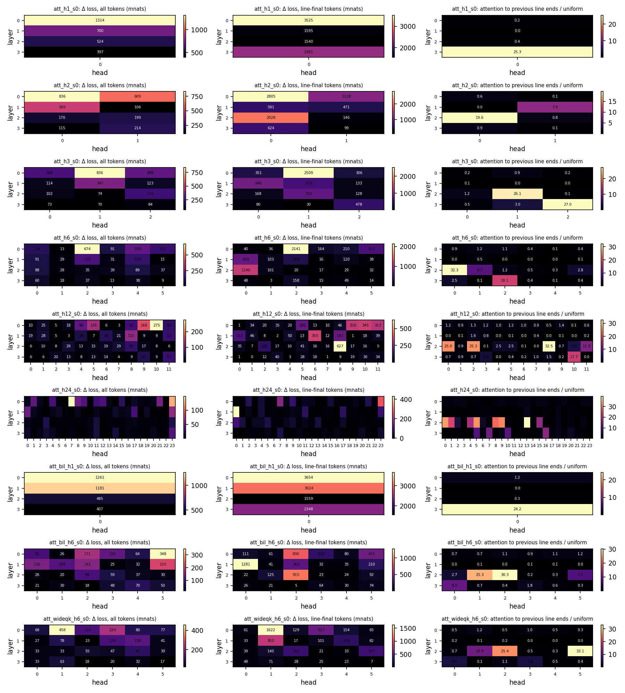
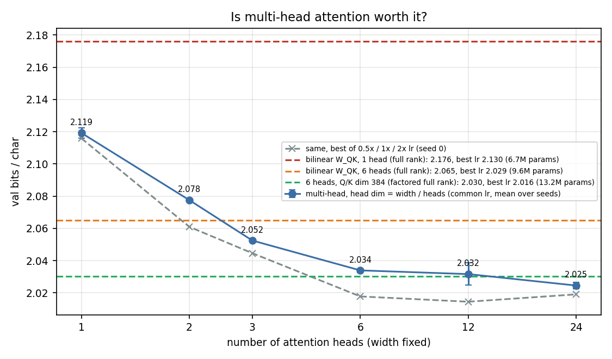
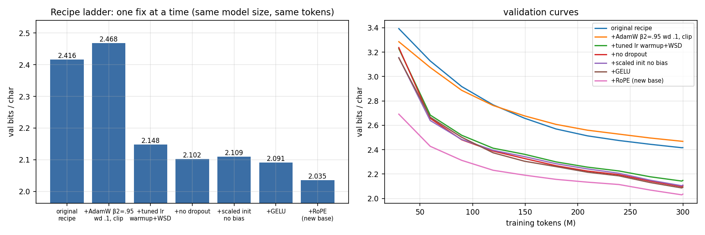
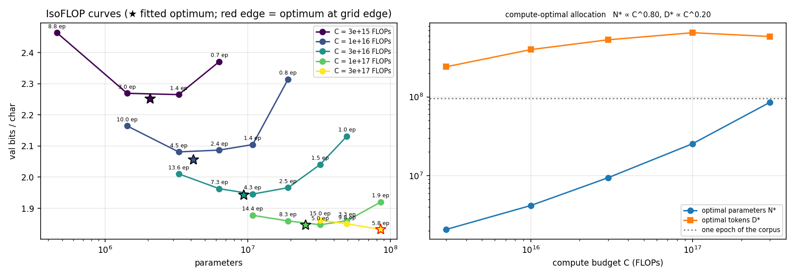

# Shaaer v2 experiments: summary

Data: 96,356,960 train tokens / 3,795,905 val tokens (BPE-512), 3,138 duplicate poems removed, 0.00% of val lines also appear verbatim in train.
Compressors on the val text (bits/char): uniform 5.285, gzip 4.511, bzip2 3.396, lzma 3.513

## Learning rate

| run | params | tokens | epochs | lr | sched | val bpc | tok/s | min |
|---|---|---|---|---|---|---|---|---|
| lr_d192_1.00e-03 | 1.87M | 200M | 2.07 | 1.0e-03 | wsd | 2.3707 | 4.57M | 0.7 |
| lr_d192_2.00e-03 | 1.87M | 200M | 2.07 | 2.0e-03 | wsd | 2.2820 | 4.56M | 0.7 |
| lr_d192_4.00e-03 | 1.87M | 200M | 2.07 | 4.0e-03 | wsd | 2.2849 | 4.55M | 0.7 |
| lr_d384_1.00e-03 | 7.28M | 200M | 2.07 | 1.0e-03 | wsd | 2.1417 | 2.15M | 1.5 |
| lr_d384_2.00e-03 | 7.28M | 200M | 2.07 | 2.0e-03 | wsd | 2.0848 | 2.16M | 1.5 |
| lr_d384_4.00e-03 | 7.28M | 200M | 2.07 | 4.0e-03 | wsd | 2.1457 | 2.16M | 1.5 |
| lr_d384_5.00e-04 | 7.28M | 200M | 2.07 | 5.0e-04 | wsd | 2.2251 | 2.16M | 1.5 |
| lr_d768_1.00e-03 | 28.71M | 200M | 2.07 | 1.0e-03 | wsd | 2.0012 | 0.81M | 4.1 |
| lr_d768_2.00e-03 | 28.71M | 200M | 2.07 | 2.0e-03 | wsd | 2.0266 | 0.81M | 4.1 |
| lr_d768_2.50e-04 | 28.71M | 200M | 2.07 | 2.5e-04 | wsd | 2.1125 | 0.81M | 4.1 |
| lr_d768_5.00e-04 | 28.71M | 200M | 2.07 | 5.0e-04 | wsd | 2.0273 | 0.81M | 4.1 |

## Recipe ladder

| run | params | tokens | epochs | lr | sched | val bpc | tok/s | min |
|---|---|---|---|---|---|---|---|---|
| ladder0_original | 7.49M | 300M | 3.11 | 3.0e-04 | constant | 2.4165 | 2.17M | 2.3 |
| ladder1_adamw_clip | 7.49M | 300M | 3.11 | 3.0e-04 | constant | 2.4679 | 2.18M | 2.3 |
| ladder2_tuned_lr_wsd | 7.49M | 300M | 3.11 | 1.8e-03 | wsd | 2.1476 | 2.19M | 2.3 |
| ladder3_no_dropout | 7.49M | 300M | 3.11 | 1.8e-03 | wsd | 2.1024 | 2.28M | 2.2 |
| ladder4_scaled_init_nobias | 7.47M | 300M | 3.11 | 1.8e-03 | wsd | 2.1092 | 2.42M | 2.1 |
| ladder5_gelu | 7.47M | 300M | 3.11 | 1.8e-03 | wsd | 2.0910 | 2.35M | 2.1 |

## Attention

| run | params | tokens | epochs | lr | sched | val bpc | tok/s | min |
|---|---|---|---|---|---|---|---|---|
| att_bil_h1_s0 | 6.69M | 300M | 3.11 | 1.8e-03 | wsd | 2.1811 | 1.71M | 2.9 |
| att_bil_h1_s0_lrx0.5 | 6.69M | 300M | 3.11 | 8.8e-04 | wsd | 2.1962 | 1.71M | 2.9 |
| att_bil_h1_s0_lrx2.0 | 6.69M | 300M | 3.11 | 3.5e-03 | wsd | 2.1304 | 1.71M | 2.9 |
| att_bil_h1_s1 | 6.69M | 300M | 3.11 | 1.8e-03 | wsd | 2.1712 | 1.71M | 2.9 |
| att_bil_h6_s0 | 9.64M | 300M | 3.11 | 1.8e-03 | wsd | 2.0669 | 0.79M | 6.3 |
| att_bil_h6_s0_lrx0.5 | 9.64M | 300M | 3.11 | 8.8e-04 | wsd | 2.0971 | 0.79M | 6.3 |
| att_bil_h6_s0_lrx2.0 | 9.64M | 300M | 3.11 | 3.5e-03 | wsd | 2.0294 | 0.79M | 6.3 |
| att_bil_h6_s1 | 9.64M | 300M | 3.11 | 1.8e-03 | wsd | 2.0630 | 0.79M | 6.3 |
| att_h12_s0 | 7.28M | 300M | 3.11 | 1.8e-03 | wsd | 2.0247 | 2.09M | 2.4 |
| att_h12_s0_lrx0.5 | 7.28M | 300M | 3.11 | 8.8e-04 | wsd | 2.0626 | 2.10M | 2.4 |
| att_h12_s0_lrx2.0 | 7.28M | 300M | 3.11 | 3.5e-03 | wsd | 2.0145 | 2.09M | 2.4 |
| att_h12_s1 | 7.28M | 300M | 3.11 | 1.8e-03 | wsd | 2.0386 | 2.08M | 2.4 |
| att_h1_s0 | 7.28M | 300M | 3.11 | 1.8e-03 | wsd | 2.1159 | 1.68M | 3.0 |
| att_h1_s0_lrx0.5 | 7.28M | 300M | 3.11 | 8.8e-04 | wsd | 2.1477 | 1.68M | 3.0 |
| att_h1_s0_lrx2.0 | 7.28M | 300M | 3.11 | 3.5e-03 | wsd | 2.1268 | 1.68M | 3.0 |
| att_h1_s1 | 7.28M | 300M | 3.11 | 1.8e-03 | wsd | 2.1226 | 1.68M | 3.0 |
| att_h24_s0 | 7.28M | 300M | 3.11 | 1.8e-03 | wsd | 2.0224 | 1.68M | 3.0 |
| att_h24_s0_lrx0.5 | 7.28M | 300M | 3.11 | 8.8e-04 | wsd | 2.0693 | 1.69M | 3.0 |
| att_h24_s0_lrx2.0 | 7.28M | 300M | 3.11 | 3.5e-03 | wsd | 2.0191 | 1.68M | 3.0 |
| att_h24_s1 | 7.28M | 300M | 3.11 | 1.8e-03 | wsd | 2.0267 | 1.69M | 3.0 |
| att_h2_s0 | 7.28M | 300M | 3.11 | 1.8e-03 | wsd | 2.0765 | 2.23M | 2.2 |
| att_h2_s0_lrx0.5 | 7.28M | 300M | 3.11 | 8.8e-04 | wsd | 2.1072 | 2.23M | 2.2 |
| att_h2_s0_lrx2.0 | 7.28M | 300M | 3.11 | 3.5e-03 | wsd | 2.0610 | 2.22M | 2.2 |
| att_h2_s1 | 7.28M | 300M | 3.11 | 1.8e-03 | wsd | 2.0787 | 2.23M | 2.2 |
| att_h3_s0 | 7.28M | 300M | 3.11 | 1.8e-03 | wsd | 2.0524 | 2.23M | 2.2 |
| att_h3_s0_lrx0.5 | 7.28M | 300M | 3.11 | 8.8e-04 | wsd | 2.1084 | 2.23M | 2.2 |
| att_h3_s0_lrx2.0 | 7.28M | 300M | 3.11 | 3.5e-03 | wsd | 2.0446 | 2.23M | 2.2 |
| att_h3_s1 | 7.28M | 300M | 3.11 | 1.8e-03 | wsd | 2.0525 | 2.23M | 2.2 |
| att_h6_s0 | 7.28M | 300M | 3.11 | 1.8e-03 | wsd | 2.0351 | 2.18M | 2.3 |
| att_h6_s0_lrx0.5 | 7.28M | 300M | 3.11 | 8.8e-04 | wsd | 2.0843 | 2.19M | 2.3 |
| att_h6_s0_lrx2.0 | 7.28M | 300M | 3.11 | 3.5e-03 | wsd | 2.0178 | 2.18M | 2.3 |
| att_h6_s1 | 7.28M | 300M | 3.11 | 1.8e-03 | wsd | 2.0328 | 2.18M | 2.3 |
| att_wideqk_h6_s0 | 13.18M | 300M | 3.11 | 1.8e-03 | wsd | 2.0288 | 0.74M | 6.8 |
| att_wideqk_h6_s0_lrx0.5 | 13.18M | 300M | 3.11 | 8.8e-04 | wsd | 2.0678 | 0.74M | 6.8 |
| att_wideqk_h6_s0_lrx2.0 | 13.18M | 300M | 3.11 | 3.5e-03 | wsd | 2.0163 | 0.74M | 6.8 |
| att_wideqk_h6_s1 | 13.18M | 300M | 3.11 | 1.8e-03 | wsd | 2.0315 | 0.74M | 6.8 |

## Schedules

| run | params | tokens | epochs | lr | sched | val bpc | tok/s | min |
|---|---|---|---|---|---|---|---|---|
| sched_constant | 7.28M | 300M | 3.11 | 1.8e-03 | constant | 2.0909 | 2.19M | 2.3 |
| sched_cosine | 7.28M | 300M | 3.11 | 1.8e-03 | cosine | 2.0735 | 2.18M | 2.3 |
| sched_wsd_sqrt | 7.28M | 300M | 3.11 | 1.8e-03 | wsd_sqrt | 2.0341 | 2.17M | 2.3 |

## Positions / MLP / dropout

| run | params | tokens | epochs | lr | sched | val bpc | tok/s | min |
|---|---|---|---|---|---|---|---|---|
| dropout_0.1 | 7.28M | 300M | 3.11 | 1.8e-03 | wsd | 2.0829 | 1.94M | 2.6 |
| mlp_relu | 7.28M | 300M | 3.11 | 1.8e-03 | wsd | 2.0471 | 2.10M | 2.4 |
| mlp_swiglu | 7.28M | 300M | 3.11 | 1.8e-03 | wsd | 2.0303 | 1.99M | 2.5 |
| pos_learned | 7.47M | 300M | 3.11 | 1.8e-03 | wsd | 2.0964 | 2.36M | 2.1 |
| pos_none | 7.28M | 300M | 3.11 | 1.8e-03 | wsd | 2.3211 | 2.23M | 2.2 |

## Depth vs width

| run | params | tokens | epochs | lr | sched | val bpc | tok/s | min |
|---|---|---|---|---|---|---|---|---|
| dw_L16_d192 | 7.18M | 300M | 3.11 | 2.9e-03 | wsd | 2.0138 | 1.08M | 4.6 |
| dw_L2_d512 | 6.56M | 300M | 3.11 | 1.4e-03 | wsd | 2.1373 | 2.77M | 1.8 |
| dw_L8_d256 | 6.43M | 300M | 3.11 | 2.4e-03 | wsd | 2.0204 | 1.66M | 3.0 |

## Batch size

| run | params | tokens | epochs | lr | sched | val bpc | tok/s | min |
|---|---|---|---|---|---|---|---|---|
| batch_262k | 7.28M | 300M | 3.11 | 1.8e-03 | wsd | 2.0982 | 2.19M | 2.3 |
| batch_32k | 7.28M | 300M | 3.11 | 1.8e-03 | wsd | 2.0031 | 2.07M | 2.4 |
| batch_65k | 7.28M | 300M | 3.11 | 1.8e-03 | wsd | 2.0330 | 2.18M | 2.3 |

## Scaling

| run | params | tokens | epochs | lr | sched | val bpc | tok/s | min |
|---|---|---|---|---|---|---|---|---|
| sc_1e+16_L3_d192 | 1.43M | 968M | 10.05 | 2.9e-03 | wsd | 2.1645 | 6.21M | 2.6 |
| sc_1e+16_L4_d256 | 3.28M | 438M | 4.55 | 2.4e-03 | wsd | 2.0810 | 3.61M | 2.0 |
| sc_1e+16_L5_d320 | 6.31M | 234M | 2.43 | 2.0e-03 | wsd | 2.0869 | 2.06M | 1.9 |
| sc_1e+16_L6_d384 | 10.82M | 139M | 1.44 | 1.8e-03 | wsd | 2.1045 | 1.26M | 1.8 |
| sc_1e+16_L6_d512 | 19.14M | 80M | 0.83 | 1.4e-03 | wsd | 2.3140 | 0.81M | 1.6 |
| sc_1e+17_L10_d640 | 49.49M | 316M | 3.28 | 1.2e-03 | wsd | 1.8601 | 0.43M | 12.3 |
| sc_1e+17_L12_d768 | 85.35M | 185M | 1.92 | 1.1e-03 | wsd | 1.9201 | 0.26M | 11.7 |
| sc_1e+17_L6_d384 | 10.82M | 1389M | 14.42 | 1.8e-03 | wsd | 1.8775 | 1.50M | 15.4 |
| sc_1e+17_L6_d512 | 19.14M | 805M | 8.35 | 1.4e-03 | wsd | 1.8594 | 1.02M | 13.1 |
| sc_1e+17_L8_d576 | 32.16M | 483M | 5.01 | 1.3e-03 | wsd | 1.8472 | 0.61M | 13.2 |
| sc_3e+15_L2_d128 | 0.46M | 847M | 8.79 | 3.9e-03 | wsd | 2.4638 | 11.44M | 1.2 |
| sc_3e+15_L3_d192 | 1.43M | 290M | 3.01 | 2.9e-03 | wsd | 2.2692 | 5.18M | 0.9 |
| sc_3e+15_L4_d256 | 3.28M | 131M | 1.36 | 2.4e-03 | wsd | 2.2651 | 2.68M | 0.8 |
| sc_3e+15_L5_d320 | 6.31M | 70M | 0.73 | 2.0e-03 | wsd | 2.3709 | 1.44M | 0.8 |
| sc_3e+16_L10_d640 | 49.49M | 95M | 0.98 | 1.2e-03 | wsd | 2.1315 | 0.38M | 4.2 |
| sc_3e+16_L4_d256 | 3.28M | 1315M | 13.64 | 2.4e-03 | wsd | 2.0107 | 3.66M | 6.0 |
| sc_3e+16_L5_d320 | 6.31M | 701M | 7.28 | 2.0e-03 | wsd | 1.9630 | 2.12M | 5.5 |
| sc_3e+16_L6_d384 | 10.82M | 417M | 4.32 | 1.8e-03 | wsd | 1.9457 | 1.48M | 4.7 |
| sc_3e+16_L6_d512 | 19.14M | 241M | 2.50 | 1.4e-03 | wsd | 1.9661 | 1.00M | 4.0 |
| sc_3e+16_L8_d576 | 32.16M | 145M | 1.50 | 1.3e-03 | wsd | 2.0407 | 0.55M | 4.4 |
| sc_3e+17_L10_d640 | 49.49M | 947M | 9.83 | 1.2e-03 | wsd | 1.8502 | 0.44M | 36.3 |
| sc_3e+17_L12_d768 | 85.35M | 555M | 5.76 | 1.1e-03 | wsd | 1.8319 | 0.28M | 33.2 |
| sc_3e+17_L8_d576 | 32.16M | 1449M | 15.03 | 1.3e-03 | wsd | 1.8621 | 0.62M | 39.2 |

## Scaling fit

```
{
 "per_budget": [
  {
   "budget": 3000000000000000.0,
   "n_runs": 4,
   "n_opt": 2071081.6721185348,
   "d_opt": 241419740.57862428,
   "bpc_opt": 2.2514052881989635,
   "interior_minimum": true,
   "points": [
    [
     459392,
     846725120,
     2.463801111963324
    ],
    [
     1426752,
     290324480,
     2.269231458016032
    ],
    [
     3279104,
     131334144,
     2.2650680724757843
    ],
    [
     6311360,
     69992448,
     2.3709269428354864
    ]
   ]
  },
  {
   "budget": 1e+16,
   "n_runs": 5,
   "n_opt": 4174001.9866675036,
   "d_opt": 399297046.81269747,
   "bpc_opt": 2.0556662581319323,
   "interior_minimum": true,
   "points": [
    [
     1426752,
     967966720,
     2.1645392509682195
    ],
    [
     3279104,
     438173696,
     2.0810362498845643
    ],
    [
     6311360,
     233701376,
     2.0868812699941146
    ],
    [
     10818432,
     138805248,
     2.104541534788893
    ],
    [
     19143168,
     80347136,
     2.3139993660822307
    ]
   ]
  },
  {
   "budget": 3e+16,
   "n_runs": 6,
   "n_opt": 9402579.292161511,
   "d_opt": 531768980.04659903,
   "bpc_opt": 1.9418690538589374,
   "interior_minimum": true,
   "points": [
    [
     3279104,
     1314521088,
     2.010677546378131
    ],
    [
     6311360,
     701104128,
     1.9629863671500802
    ],
    [
     10818432,
     416677888,
     1.9456782569094797
    ],
    [
     19143168,
     241303552,
     1.9661245913203262
    ],
    [
     32155200,
     144834560,
     2.0406510541454987
    ],
    [
     49493120,
     94633984,
     2.1315228756807647
    ]
   ]
  },
  {
   "budget": 1e+17,
   "n_runs": 5,
   "n_opt": 25477645.593969848,
   "d_opt": 654168243.497798,
   "bpc_opt": 1.846256128869376,
   "interior_minimum": true,
   "points": [
    [
     10818432,
     1389101056,
     1.877493050363105
    ],
    [
     19143168,
     804519936,
     1.8593897375184671
    ],
    [
     32155200,
     482869248,
     1.8471548989235815
    ],
    [
     49493120,
     315752448,
     1.860088473328525
    ],
    [
     85347072,
     184942592,
     1.9200562739542952
    ]
   ]
  },
  {
   "budget": 3e+17,
   "n_runs": 3,
   "n_opt": 85347072.00000007,
   "d_opt": 585843179.2481405,
   "bpc_opt": 1.8319111368671137,
   "interior_minimum": false,
   "points": [
    [
     32155200,
     1448607744,
     1.8620529142136344
    ],
    [
     49493120,
     947388416,
     1.8501675677093583
    ],
    [
     85347072,
     555089920,
     1.8319111368671135
    ]
   ]
  }
 ],
 "law": {
  "n_opt_exponent": 0.8022553461631277,
  "d_opt_exponent": 0.1977446538368705
 }
}
```

## Generation (P4_generation.json)

| model | well_formed | rhyme_consistency | repeated_rhyme_word | copied | invented_words | invented_rhyme_words | hemistich_chars |
|---|---|---|---|---|---|---|---|
| real | 1.000 | 0.867 | 0.064 | 0.000 | 0.015 | 0.037 | 24.210 |
| ladder0_original | 0.969 | 0.775 | 0.163 | 0.000 | 0.046 | 0.190 | 22.984 |
| att_h6_s0 | 0.999 | 0.777 | 0.120 | 0.000 | 0.023 | 0.097 | 24.750 |
| att_h1_s0 | 0.988 | 0.697 | 0.135 | 0.000 | 0.023 | 0.097 | 24.378 |
| att_bil_h1_s0 | 0.998 | 0.746 | 0.109 | 0.000 | 0.022 | 0.081 | 24.690 |

## Generation (P10_generation_scaled.json)

| model | well_formed | rhyme_consistency | repeated_rhyme_word | copied | invented_words | invented_rhyme_words | hemistich_chars |
|---|---|---|---|---|---|---|---|
| real | 1.000 | 0.867 | 0.064 | 0.000 | 0.015 | 0.037 | 24.210 |
| sc_3e+15_L4_d256 | 0.995 | 0.724 | 0.120 | 0.000 | 0.036 | 0.144 | 23.952 |
| sc_1e+16_L4_d256 | 0.998 | 0.774 | 0.083 | 0.000 | 0.029 | 0.131 | 23.696 |
| sc_3e+16_L6_d384 | 1.000 | 0.800 | 0.125 | 0.000 | 0.021 | 0.094 | 24.236 |
| sc_1e+17_L8_d576 | 1.000 | 0.840 | 0.104 | 0.000 | 0.017 | 0.071 | 24.667 |
| sc_3e+17_L12_d768 | 1.000 | 0.834 | 0.099 | 0.000 | 0.014 | 0.059 | 24.615 |

## Figures





